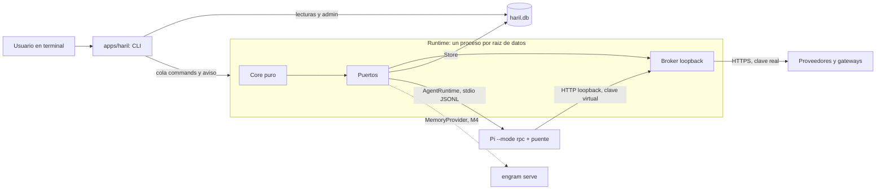

# HARIL

> **Many minds. One flow.**

Una consola, múltiples inteligencias, un solo propósito.
HARIL es una plataforma **local** de orquestación de agentes de IA, desarrollo de software y automatización, con un solo comando: `haril`.
Un núcleo propio controla la ejecución; Pi, Engram, Herdr y los proveedores de modelos quedan detrás de puertos reemplazables.

> **Estado real (2026-10-16).** Fases 0 a 2 completadas en diseño. **Fase 3 (monorepo) implementada** en `feat/phase-3-monorepo`. **M1 implementado** en `feat/phase-4-m1`: Store SQLite (`node:sqlite`), runtime en primer plano (`haril start`), agente simulado y recuperación tras una caída (`kill -9`).
> Aún no existen Pi, Broker ni proveedores reales: llegan en M2 y M3. Hasta entonces los agentes son simulados.

## Cómo probarlo

Requisitos: Node 24 (recomendado `^24.21.0`; con 24.19 funciona y `doctor` avisa) y `corepack` (incluido en Node 24). Los pasos son para PowerShell, desde la raíz del repositorio.

1. Instalar dependencias y compilar la CLI:

   ```powershell
   corepack pnpm install
   npm run build
   ```

2. Comprobar el entorno. `doctor` sale con 0 (correcto) o 1 (advertencias, por ejemplo Node 24.19):

   ```powershell
   .\bin\haril.ps1 doctor
   ```

3. Usar una carpeta de prueba y una raíz de datos propia para no tocar la predeterminada:

   ```powershell
   $env:HARIL_HOME = "$env:TEMP\haril-demo\data"
   New-Item -ItemType Directory -Force "$env:TEMP\haril-demo\proyecto" | Out-Null
   ```

4. Crear el proyecto. Sin `--yes` solo se muestra la vista previa y no se escribe nada:

   ```powershell
   .\bin\haril.ps1 project init "$env:TEMP\haril-demo\proyecto" --name Demo --slug demo
   .\bin\haril.ps1 project init "$env:TEMP\haril-demo\proyecto" --name Demo --slug demo --yes
   ```

5. Encolar trabajo. `task add` y `plan import` solo dejan comandos en la cola; `start` los aplica:

   ```powershell
   .\bin\haril.ps1 task add "Tarea de prueba" --project demo
   .\bin\haril.ps1 plan import examples\plan.valid.json --project demo
   ```

6. Ejecutar la cola. `start` corre en primer plano y sale al quedar ocioso (0 si todo fue bien, 1 si una tarea falló):

   ```powershell
   .\bin\haril.ps1 start --project demo
   ```

7. Consultar el resultado:

   ```powershell
   .\bin\haril.ps1 status --project demo
   .\bin\haril.ps1 metrics --project demo
   .\bin\haril.ps1 events --project demo --limit 10
   ```

8. Limpiar la variable de sesión: `Remove-Item Env:HARIL_HOME`.

Notas:

- **Agentes simulados hasta M2.** `fake:succeed` (por defecto), `fake:fail` y `fake:slow:<ms>` se comportan como su nombre indica. Cualquier otro agente del plan (por ejemplo `developer-block`) se ejecuta como simulado con éxito y `start` lo indica. Ningún agente real modifica el disco.
- **Otras formas de invocar la CLI.** `bin\haril.cmd` (cmd) y `sh bin/haril` (POSIX) hacen lo mismo. No editan el `PATH`. Si falta `apps/haril/dist/haril.mjs`, avisan de que hay que ejecutar `npm run build`.
- **Códigos de salida.** 0 correcto, 1 advertencias o tarea fallida, 2 error de uso o de entorno.

Calidad del repositorio:

| Comando | Qué ejecuta |
|---|---|
| `corepack pnpm run check` | Biome, `tsc --noEmit` por workspace, `scripts/check-layers`, `check-purity`, `check-forbidden` y knip |
| `corepack pnpm test` | Vitest (contratos, core, CLI) y `node:test` (scripts de control con violaciones sembradas) |
| `npm run e2e` | Compila y recorre el flujo M1 completo con la CLI en directorios temporales, incluida una caída a mitad de run (`scripts/e2e.mjs`) |

El CI (`.github/workflows/ci.yml`) ejecuta lo mismo en `windows-latest` y `ubuntu-latest`.

## Qué es y qué no es

Fuente: `docs/PRODUCT_VISION.md` 1 y 4.

| Es | No es |
|---|---|
| Un único punto de control: un Runtime bajo demanda por raíz de datos, propietario del estado; ningún agente lanza agentes | Un fork ni un reemplazo de Pi: lo ejecuta como proceso externo `--mode rpc`, con versión fijada |
| Gasto acotado por código: presupuesto de pago 0 por defecto, Broker local con corte a mitad de flujo | Una copia de Gentle Shell, Gentle AI o DC-Pi: son referencias de diseño |
| Permisos reales: `PathGuard`, motor de políticas y aprobaciones atadas a hash, aplicados por el Runtime y no por un prompt | Un emulador de terminal: funciona en terminal estándar; Herdr es opcional |
| Recuperación: el estado vive en `haril.db` con fencing; los procesos son desechables | Una base de memoria nueva: Engram es el proveedor principal |
| Resultado verificable: comprobaciones que ejecuta el host, no la respuesta del agente | Un servicio de enrutado para terceros ni un agregador de suscripciones |
| Piezas sustituibles e instalación aislada que coexiste con lo ya instalado | Un agente LLM supervisor, un framework ni un sandbox: el MVP declara N0 |

## Arquitectura en diez líneas

Fuente: `docs/ARCHITECTURE.md` 3 a 5.

1. **Hexágono.** Un Core puro (`packages/core`) decide y no toca el mundo; los adaptadores abren archivos, procesos, sockets y la base.
2. **Un Runtime por raíz de datos**, bajo demanda: nace con `haril start`, toma una lease con época en SQLite y muere por ocio. Sin servicios ni autoarranque.
3. **La CLI** (`apps/haril`) lee `haril.db` y encola comandos en `commands`; el Runtime los drena.
4. **Pi no es frontera de seguridad.** Corre como hijo `--mode rpc`, uno por intento, sin herramientas integradas.
5. **El puente** (`agent-pi-bridge`, extensión `-e`) reenvía cada operación de archivo y shell al Runtime, que la autoriza (PDP) y la ejecuta.
6. **El Broker** en loopback recibe las llamadas de Pi con una clave virtual de alcance de run y reenvía al proveedor con la clave real.
7. **Puertos con suite de contrato** (19 en ARCH 5.1): `Store`, `AgentRuntime`, `ModelProvider`, `BrokerControl`, `MemoryProvider`, `TerminalHost`, `ProcessSupervisor`, `SandboxBackend`, `SecretStore`, entre otros.
8. **Todo es bloque declarativo** (`BlockManifest v1`, diez categorías): agentes, herramientas, metodologías, verificadores.
9. **Las restricciones críticas son código**: fencing, `PathGuard`, reserva de presupuesto, cerrojos de superficie, regla de dos.
10. **Honestidad de evidencia**: el MVP declara N0 y trata los spikes pendientes como puertas de cada hito.



## Índice de documentación

Todo bajo `docs/` salvo indicación. Los cinco últimos documentos de la primera tabla se redactan en paralelo con este README.

| Documento | Una línea |
|---|---|
| `ARCHITECTURE.md` | Arquitectura consolidada ("ARCH x.y"): componentes, procesos, puertos, monorepo, flujos, datos, seguridad, recuperación y estado de verificación. **Manda sobre los demás** |
| `DECISIONS.md` | Registro maestro: qué fija el prompt, 20 ADR, decisiones del usuario U-01 a U-18 y UA-01 a UA-08, spikes e inconsistencias |
| `REQUIREMENTS.md` | RF-001 a RF-252, RNF-001 a RNF-052, CU-01 a CU-18 y su cobertura del prompt (sección 7) |
| `PRODUCT_VISION.md` | Visión, usuarios, problema, qué no es HARIL, alcance por fases y criterios de éxito |
| `COMPONENTS.md` | Fichas de los 19 componentes con las 13 preguntas de PROMPT sec19 y cobertura de requisitos (sección 8) |
| `ORCHESTRATION.md` | DAG, `Task v1`, siete estados, `claim`, superficies, resultado verificable, reintentos, recuperación y Taxis |
| `AGENTS.md` | Agent Blocks, cuatro arquetipos, `AgentSpec`, ciclo de un run, permisos y delegación por DAG |
| `BLOCK_SYSTEM.md` | `BlockManifest v1`, diez categorías, registro, cuarentena, metodologías y sustitución |
| `MODEL_ROUTING.md` | Router, Broker, proveedores, niveles A/B/C, presupuestos, `costSource` y política de gasto |
| `MEMORY.md` | Las seis memorias, `MemoryProvider`, `ScopeRef`, outbox e integración con Engram |
| `DATA_MODEL.md` | Esquema lógico de `haril.db`: tablas, fencing, invariantes INV-nn, migraciones |
| `PROJECTS.md` | `haril project init`, `ProjectManifest v1`, `.haril/`, abrir, configurar y cerrar |
| `INTERFACE.md` | Terminal estándar, `TerminalHost`, TUI (`apps/shell`, M4) y adaptador de Herdr |
| `INSTALLATION.md` | Bootstrap, journal, manifiesto, Node fijado, instalación de Pi, coexistencia, `doctor`, `update` y `rollback` |
| `COMPATIBILITY.md` | Matriz por herramienta (versión, licencia, conflictos, estrategia, riesgo) y entorno local verificado |
| `SECURITY.md` | Amenazas, niveles N0/N1/N2, `PathGuard`, secretos y claves virtuales, aprobaciones, auditoría, inyección |
| `TEST_STRATEGY.md` | Carriles, fakes, suites de contrato, INV-nn, las 12 pruebas y los 15 criterios, cobertura (sección 11) |
| `ROADMAP.md` | Fases e hitos M0 a M4 con puertas y autorizaciones |
| `MVP.md` | Alcance mínimo, arquitectura de ejecución de los 11 pasos y pruebas E2E |
| `BACKLOG.md` | Historias BL-nnn por hito con orden de arranque |
| `RISKS.md` | Matriz de riesgos RK-nnn |
| `GLOSSARY.md` | Terminología de HARIL con "dónde se define" por término |

| Carpeta o archivo | Qué contiene |
|---|---|
| `adrs/` | ADR-0001 a ADR-0020, cada uno con estado (`confirmada-por-prompt`, `propuesta`, `requiere-autorizacion`) |
| `contracts/` | Índice y plantilla (`README.md`) y once contratos `v1 borrador` por puerto (`agent-runtime`, `task-store`, `orchestrator`, `executor`, `memory`, etc.) |
| `research/` | Fase 0: síntesis `00` y dossiers `01` a `15` (Pi, Gentle Shell, Gentle AI, Herdr, Engram, DC-Pi, gateways, proveedores, entorno, SQLite, monorepo, seguridad en Windows) |
| `source/MASTER_PROMPT.md` | Fuente primaria de requisitos ("PROMPT secN"); no se edita, sus cambios se registran en `DECISIONS.md` |
| `../odd/tasks/haril-foundations.md` | Documento ODD del propio proyecto: objetivo, alcance autorizado y tareas |

## Cómo continuar este proyecto

Para quien retome el trabajo sin acceso a ninguna conversación previa.

**Orden de lectura**

1. Este README.
2. `docs/DECISIONS.md`: "Resumen" y sección 4 (qué debe decidir el usuario).
3. `docs/ARCHITECTURE.md`: secciones 1 a 4 y 14 (qué está probado: nada).
4. `docs/ROADMAP.md`.
5. `docs/BACKLOG.md`, "Orden de arranque".

Los dossiers de `docs/research/` se leen solo bajo demanda, cuando un documento de diseño los cite.

**Convenciones**

| Convención | Regla |
|---|---|
| Etiquetas de evidencia | `[V]` verificado en fuente primaria (leído, no ejecutado), `[R]` reportado, `[I]` inferido, `[S]` decisión de diseño, NO VERIFICADO sin evidencia |
| Identificadores | Tal cual en las fuentes: RF/RNF/CU, ADR-NNNN, U-nn/UA-nn, AR-Gnn, INV-nn, H1 a H15, M0 a M4, "PROMPT secN", "ARCH x.y", "NN secX" |
| Idioma | Español neutro profesional; identificadores, código y URLs en su forma original |
| "Nada probado" | Ninguna cifra ni comportamiento es definitivo hasta releerlo en la fuente exacta y pasar su puerta |
| Jerarquía | `ARCHITECTURE.md` y los ADR mandan; quien difiera registra la diferencia, no corrige ARCH |
| Decisiones del usuario | Siempre con su postura segura por defecto; ninguna está cerrada |

**Qué debe decidir el usuario antes de implementar.** Las 26 decisiones de `docs/DECISIONS.md` 4 (U-01 a U-18, UA-01 a UA-08) y su efecto por hito en 4.3. M0 no empieza sin U-07 (a) (`git init`, gestor de paquetes) y UA-04 (instalar herramientas); M2 espera U-08 (spikes con Pi 1.2.0 aislado).

**Siguiente tarea concreta.** La primera historia del "Orden de arranque" de `docs/BACKLOG.md`.

## Trazabilidad

| Eslabón | Dónde vive |
|---|---|
| Prompt → requisitos | `docs/REQUIREMENTS.md` 7 (tabla de cobertura del prompt) |
| Requisitos → arquitectura | `docs/ARCHITECTURE.md` 15 (trazabilidad a PROMPT) |
| Requisitos → componentes | `docs/COMPONENTS.md` 8 (cobertura de requisitos) |
| Requisitos → tareas | `docs/BACKLOG.md` (historias BL-nnn vinculadas a RF y a hitos) |
| Requisitos → pruebas | `docs/TEST_STRATEGY.md` 11 (cobertura de requisitos) |

## Licencia

**Sin definir** (UA-08, `docs/DECISIONS.md` 4.2). Mientras no se decida, no se declara licencia, no se publica ni se redistribuye nada.

## Créditos

Herramientas estudiadas en la Fase 0 (solo lectura), con la licencia que registra `docs/COMPATIBILITY.md` 7.1. No se copió código de ninguna.

| Herramienta | Licencia | Uso en HARIL |
|---|---|---|
| Pi (`@earendil-works/pi-coding-agent`) | MIT | Proceso externo `--mode rpc` |
| Gentle Shell | MIT | Referencia de la TUI |
| Gentle AI | MIT (14 de 15 skills declaran Apache-2.0) | Referencia; ODD redactado por HARIL |
| Herdr | Apache-2.0 (AGPL-3.0-or-later hasta 0.7.x) | Proceso externo opcional (M4) |
| Engram | MIT | Proceso externo (M4) |
| DC-Pi | MIT | Referencia |
| MXC | MIT | Adaptador de sandbox (M4) |
| Node.js, SQLite, Git | MIT, dominio público, GPL-2.0 (CLI externo) | Runtime, base embebida, CLI |
