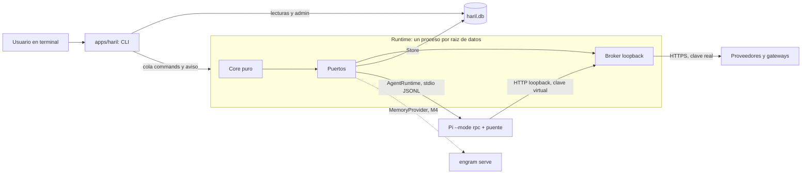

# HARIL

**¿Primera vez?** Consulta la [guía completa de uso](docs/GUIA_DE_USO.md): instalación, modos, comandos, paneles laterales e interpretación de cada indicador.

**¿Quieres decidir los próximos cambios?** Abre el [plan editable de integración](docs/PLAN_INTEGRACION_EDITABLE.md). Es una propuesta para revisar y modificar, no una implementación.

## Windows 11: instalar desde cero, sin clonar HARIL (PowerShell)

Los comandos funcionan desde cualquier carpeta, también `C:\Windows\System32`. Instala primero Node.js y Corepack; después ejecuta el instalador remoto de HARIL. No necesitas `git clone`, `git pull` ni conservar fuentes.

### Paso 1. Instalar Node.js

En PowerShell:

```powershell
winget --version
winget install --id OpenJS.NodeJS.LTS --exact --accept-package-agreements --accept-source-agreements
```

**Cierra PowerShell completamente y vuelve a abrirlo** al terminar. Comprueba:

```powershell
node --version
npm.cmd --version
Get-Command node
```

HARIL necesita **Node 24.21.0 o superior de la serie 24, o Node 26.8.0 o superior**. Por ejemplo, `v24.19.0` no sirve aunque sea LTS. Si la versión instalada es anterior:

```powershell
winget upgrade --id OpenJS.NodeJS.LTS --exact --accept-package-agreements --accept-source-agreements
```

Si `winget` no tiene una versión compatible o no está disponible, instala Node desde [nodejs.org/en/download](https://nodejs.org/en/download) (en equipos corporativos puede requerir autorización de TI). Vuelve a abrir PowerShell y verifica `node --version`.

### Paso 2. Instalar Corepack si hace falta

```powershell
corepack.cmd --version
```

Si no se reconoce:

```powershell
npm.cmd install --global corepack
corepack.cmd --version
```

Se utiliza `npm.cmd` para evitar la restricción habitual de PowerShell sobre `npm.ps1`. No necesitas instalar `pnpm` por separado: HARIL utiliza Corepack y la versión de pnpm fijada en el proyecto.

### Paso 3. Instalar HARIL y Gentle Shell

**Copia este bloque completo en PowerShell**. Descarga el script a una carpeta temporal y comprueba los códigos de salida:

```powershell
$script = Join-Path $env:TEMP "haril-install-online.ps1"

curl.exe -fL --retry 3 --connect-timeout 20 "https://raw.githubusercontent.com/anderson-camacho/HARIL/main/scripts/install-online.ps1" -o $script

if ($LASTEXITCODE -ne 0 -or -not (Test-Path -LiteralPath $script)) {
    throw "No se pudo descargar el instalador de HARIL."
}

powershell.exe -NoProfile -ExecutionPolicy Bypass -File $script

if ($LASTEXITCODE -ne 0) {
    throw "La instalación falló. Revisa el error anterior."
}
```

El instalador obtiene la fuente de `main` en una carpeta temporal (primero ZIP y, si falla, Git), ejecuta el instalador estándar, registra HARIL para tu usuario en `%LOCALAPPDATA%\HARIL` e intenta instalar `gentle-pi@4.1.0` (**Gentle Shell**) solo si no existe. Mantiene la configuración existente de Gentle Shell. No instala ni modifica el `gentle-ai` global independiente.

### Paso 4. Verificar (nueva ventana de PowerShell)

```powershell
haril --version
haril doctor
gentle-shell --version
```

Si `haril` no se reconoce pero se instaló:

```powershell
& "$env:LOCALAPPDATA\HARIL\bin\haril.cmd" --version
$env:Path += ";$env:LOCALAPPDATA\HARIL\bin"
haril --version
```

Si únicamente falla Gentle Shell:

```powershell
npm.cmd install --global gentle-pi@4.1.0 --no-fund --no-audit
gentle-shell --version
```

### Paso 5. Usar y actualizar

```powershell
haril
haril update --check
haril update
# Sin pregunta de confirmación:
haril update --yes
```

`haril update` consulta `main` sin checkout local e instala una versión superior con confirmación. También prepara sus dependencias adicionales, como el Matrix original de TerminalTextEffects, dentro de la carpeta de HARIL. Si la versión ya es la última pero falta una de esas herramientas, permite repararla en la siguiente ejecución. Cierra los procesos de HARIL antes de actualizar.

### Recuperación: Gentle Shell tiene lanzador pero falta el módulo

Si `gentle-shell.cmd --version` termina con `Cannot find module ...\AppData\Roaming\npm\node_modules\gentle-pi\bin\gentle-shell.mjs`, **Gentle Shell quedó parcialmente instalado**. No es un problema de HARIL ni de `ExecutionPolicy`. El instalador actual solo comprueba si el comando existe, así que puede pasar por alto un lanzador huérfano. Después de actualizar Node a una versión compatible:

```powershell
Test-Path "$env:APPDATA\npm\node_modules\gentle-pi\bin\gentle-shell.mjs"
npm.cmd install --global gentle-pi@4.1.0 --no-fund --no-audit
gentle-shell.cmd --version
```

Si npm detecta un conflicto de instalación anterior, repara el paquete sin borrar los hogares o configuraciones `~\.gentle-shell` ni `~\.pi`:

```powershell
npm.cmd uninstall --global gentle-pi
npm.cmd install --global gentle-pi@4.1.0 --no-fund --no-audit
gentle-shell.cmd --version
```

Comprueba HARIL **por su ruta real**, aunque el comando global no esté en el PATH:

```powershell
$haril = Join-Path $env:LOCALAPPDATA "HARIL\bin\haril.cmd"
Test-Path $haril
& $haril --version
& $haril doctor
```

`Test-Path = True` solo prueba que el archivo existe; `& $haril --version` confirma que funciona. Para habilitarlo en la terminal actual: `$env:Path += ";$env:LOCALAPPDATA\HARIL\bin"`. Si se actualizó Node hace poco, abre **una terminal nueva** antes de probar.

### Solución de errores habituales

- **`node` no existe**: instala Node, reabre PowerShell y ejecuta `where.exe node`.
- **`Node 24.21+ is required`**: tienes una versión antigua; revisa `node --version` y actualízala.
- **`corepack` no existe**: prueba `corepack.cmd --version`; si falla, ejecuta `npm.cmd install --global corepack`.
- **Errores TLS o GitHub bloqueado**: revisa conexión a `raw.githubusercontent.com`, `codeload.github.com` y al registro de npm; la alternativa Git puede funcionar con HTTP/1.1, pero no evita todas las restricciones de red.
- **`haril` no se reconoce**: ejecuta el lanzador en `%LOCALAPPDATA%\HARIL\bin\haril.cmd` y agrega la carpeta al PATH con el comando anterior.
- **`gentle-shell` no se reconoce**: instala ese componente separado con `npm.cmd install --global gentle-pi@4.1.0` y reabre PowerShell.
- **Bloqueos corporativos**: solicita los permisos a TI; no desactives TLS, antivirus ni la política global de ejecución.

**Seguridad:** actualmente el instalador remoto ejecuta código de la rama `main` (canal de desarrollo, sin artefactos oficiales firmados). [Inspecciona el script](https://github.com/anderson-camacho/HARIL/blob/main/scripts/install-online.ps1) antes de ejecutarlo.

---

## Instalación sencilla (Windows, macOS y Linux)

**No necesitas clonar HARIL, ejecutar `git pull` ni conservar una copia del repositorio.** El instalador descarga la versión de `main` a una carpeta temporal, ejecuta el instalador de HARIL, agrega su ejecutable al PATH de usuario y limpia la carpeta temporal. **Por ahora `main` es un canal de desarrollo sin artefactos firmados**: revisa los scripts antes de ejecutarlos.

**Windows 11, PowerShell** (un solo comando, usando `curl.exe` en lugar de `Invoke-WebRequest` para reducir errores TLS observados):

```powershell
curl.exe -fL --retry 3 --connect-timeout 20 https://raw.githubusercontent.com/anderson-camacho/HARIL/main/scripts/install-online.ps1 -o "$env:TEMP\haril-install-online.ps1"; if ($LASTEXITCODE -eq 0) { powershell.exe -NoProfile -ExecutionPolicy Bypass -File "$env:TEMP\haril-install-online.ps1" }
```

**macOS o Linux** (necesitas `bash`, `curl` y `unzip`, o `git` para la alternativa; `pipefail` impide que una descarga fallida parezca exitosa):

```sh
bash -o pipefail -c 'curl -fsSL --retry 3 https://raw.githubusercontent.com/anderson-camacho/HARIL/main/scripts/install-online.sh | bash'
```

Requisitos: Node **24.21.0+** (o 26.8.0+), conectividad para bajar componentes y npm. El instalador primero intenta el ZIP de GitHub (codeload) y, si no llega, hace un fetch de Git temporal con HTTP/1.1 y hasta tres intentos. No modifica ramas ni commits de tus proyectos. Si ambos métodos fallan, informa el error y no inventa un éxito.

Instala HARIL para tu usuario y, cuando no existe, **Gentle Shell standalone** mediante `npm install -g gentle-pi@4.1.0`: incluye el acompañante Gentle AI nativo de `gentle-pi`; no instala ni actualiza un `gentle-ai` global independiente ni altera el Pi de HARIL. Si Gentle Shell ya existe, se conserva sin cambios. Si falla únicamente el acompañante, informa cómo reintentarlo sin ocultar que HARIL ya está instalado.

Después de abrir una terminal **nueva**:

```powershell
haril --version
haril doctor
haril update --check
haril update
```

`haril update` verifica una versión mayor en `main` y solicita confirmación en una consola interactiva; `haril update --yes` la instala sin preguntar; `haril update --check` solamente consulta. El instalador también instala las dependencias visuales añadidas y puede repararlas si faltan aun con la misma versión. Sigue disponible `haril update --from <ruta-local>` para desarrollo. Las actualizaciones se rechazan cuando HARIL detecta un runtime activo o no puede validar su estado, y nunca bajan la versión automáticamente.

Opciones del instalador: en Windows ejecuta el script descargado con `-NoGentleShell`, `-NoPath` o `-KeepSource` para omitir el acompañante, no agregar PATH de usuario o conservar la descarga temporal, respectivamente. En macOS/Linux usa `HARIL_NO_GENTLE_SHELL=1`, `HARIL_NO_PATH=1` o `HARIL_KEEP_SOURCE=1` como variables de entorno.

> **Seguridad y límites:** el comando remoto ejecuta código del repositorio; consulta `scripts/install-online.ps1` o `scripts/install-online.sh` antes de ejecutarlo. Esta vía no ofrece todavía firmas de release, pinning criptográfico del contenido descargado ni actualización/rollback atómicos. Si la red bloquea GitHub o npm, ninguna variante puede instalar sus dependencias sin una fuente alternativa confiable.


> **Many minds. One flow.**

Una consola, múltiples inteligencias, un solo propósito.
HARIL es una plataforma **local** de orquestación de agentes de IA, desarrollo de software y automatización, con un solo comando: `haril`.
Un núcleo propio controla la ejecución; Pi, Engram, Herdr y los proveedores de modelos quedan detrás de puertos reemplazables.

> **Estado real (2026-10-18): versión 0.20.2, `haril` abre Pi con cuatro modos (acción, consulta de solo lectura, plan y delegación), un botón `■ STOP ALL` siempre a la vista, la vista de orquestación con el workflow real y lo que escribe cada agente en vivo, y el modelo y su nivel de razonamiento a la vista, y el runtime corre workflows de delegación en tres capas (`haril workflow start` o la tarjeta `/delegate`) con agentes reales de Pi que, en un proyecto git, escriben en paralelo en worktrees y dejan una rama de integración para que la revises, o con agentes simulados, eligiendo el modelo de cada agente según la tarea, la cuota y una tabla de dificultad, con el contexto, el modelo y el nivel de cada capa configurables desde `TOOLS`; `haril stop --now` los para a todos al instante.** El MVP se cerró en 0.6.0: sus 15 criterios de aceptación se cumplen o tienen un desvío explícito y justificado (ver `versions/`). En 0.7.0 se escribía un objetivo, se revisaba y aprobaba el plan que propone el agente `planner` y se seguían sus tareas en vivo; está probado con un modelo real a través de CLIProxyAPI (ver [Demo en vivo](#demo-en-vivo)). En 0.8.0, `haril` en una terminal abre Pi, el que instala HARIL, con una extensión de HARIL: todo Pi (`/login`, `/model`, el nivel de razonamiento), una barra amarilla y los comandos `/goal`, `/plans`, `/approve` y `/tasks` para pedir un plan, aprobarlo y seguir sus tareas (ver [Consola de HARIL sobre Pi](#m4-consola-de-haril-sobre-pi-haril)); la interfaz anterior sigue en `haril shell`. En 0.9.0, la consola tiene paneles con clic y el módulo `ORCHESTRATION` muestra la vista de workflow aprobada, por ahora solo con datos de ejemplo (`/orchestration demo`), porque el motor de delegación aún no existe. En 0.10.0, la barra y las cabeceras muestran siempre el modelo y su nivel de razonamiento, un clic los cambia y cada modelo de CLIProxyAPI ofrece solo los niveles que publica. En 0.11.0, el Core valida lo que proponen los agentes, decide qué tareas arrancan sin pasar ningún límite, elige el modelo de cada agente según quién lo fijó, la tabla de dificultad y la cuota, acota los reprocesos y da el veredicto del vigilante de 15 minutos; son funciones puras que todavía no usa ningún runtime. Desde esta versión, `npm run check` y la CI fallan si un cambio entregado no sube la versión (`scripts/bump-version.mjs`). En 0.12.0, el almacén guarda workflows, propuestas, veredictos y continuaciones que corren aunque un hijo falle; `haril workflow demo` muestra un árbol simulado de orquestador, delegadores, ejecutores y auditores sin pasar ningún límite, y cada orden y cada intento quedan en un registro con cadena de hashes que `haril usage` lee y verifica. En 0.13.0, el runtime corre varios agentes a la vez sin pasar los límites, y `haril workflow start` encola un workflow que el runtime ejecuta: el orquestador delega, cada delegador asigna pasos, cada ejecutor tiene su auditor, un rechazo se relanza una vez y escala otra, quien delegó no gasta nada mientras espera y vuelve con los resultados de sus hijos, y un auditor final cierra el trabajo; tras una caída, el runtime sigue sin repetir trabajo (ver [Delegación en tres capas y registro de consumo](#delegación-en-tres-capas-y-registro-de-consumo)). En 0.14.0, los agentes de la delegación son reales: `haril workflow start <objetivo> --agent orchestrator --autonomous` corre el orquestador, los delegadores, los ejecutores y sus auditores en Pi a través del Broker, de principio a fin y sin intervención, y ninguno escribe ni ejecuta comandos todavía; un workflow real de lectura y análisis con `cliproxy/gemini-3-flash` terminó completado (`npm run e2e:workflow-real`). En 0.15.0 llega la parada de emergencia: `haril stop --now` para todos los agentes de todos los modos, mata el árbol de procesos de cada uno (solo los que HARIL registró, comprobando el pid y su hora de inicio), cancela lo que estaba en curso, detiene los workflows, liquida sus presupuestos y deja el runtime detenido hasta `haril resume`; en una parada real con agentes de Pi en marcha no quedó ningún proceso vivo, 0,4 s después de la orden (`npm run e2e:stop-real`). `haril workflow stop <id>` para un solo workflow, el arranque mata los procesos que dejó un runtime caído, un segundo Ctrl+C ya no deja hijos huérfanos y un vigilante de código, sin tokens, revisa cada 15 minutos cada agente vivo: cierra el que no avanza y cancela el que ya nadie espera (ver [Paradas y vigilante](#paradas-y-vigilante)). En 0.16.0 la consola tiene cuatro modos, siempre a la vista en la barra y cambiables con un clic, `Alt+M` o `/mode`: acción (Pi como siempre), consulta (solo lee; no puede escribir, editar ni ejecutar nada, muestra qué hizo y cómo, y guarda una investigación en Markdown si se la pides), plan (arma un plan con la conversación y `/goal` lo pasa al `planner`) y delegación (lo que escribes abre la tarjeta `/delegate`, que arranca un workflow con agentes reales cuando la confirmas, con las paradas que dijiste). El botón `■ STOP ALL` (o `Alt+X`) corta el turno del chat y ejecuta `haril stop --now` sin pedir confirmación. Cada orden y cada respuesta del modelo en la consola quedan en el registro de consumo (`haril usage record`). En 0.17.0 la vista de orquestación deja de ser una maqueta: el módulo `ORCHESTRATION` sigue el último workflow del proyecto (o el que elijas con `P`) con `haril workflow watch`, que emite una instantánea por cada cambio, y la vista en vivo (`L`) muestra lo que el agente seleccionado escribe y las herramientas que llama, leído de su sesión de Pi con `haril workflow tail`; lo que el workflow todavía no tiene se dibuja como `n/a`, y la demostración sigue disponible y rotulada. El módulo `WORKFLOWS` se retira: las metodologías se navegan desde `TOOLS`. Además, `haril stop --now` después de un `haril stop` normal mata a todos los agentes al instante, y ninguna parada da por limpio un proceso cuya muerte no se comprobó. En 0.18.0 llegan la cuota y la elección de modelos: `haril quota` muestra el uso de las ventanas de 5 horas y semanal de cada cuenta de CLIProxyAPI (o «sin dato» si no se puede leer), el runtime elige el modelo de cada hijo del catálogo real con las reglas de cuota (más del 80 % de la ventana de 5 horas, otro modelo o cuenta; más del 80 % de la semana, no se usa; menos del 20 % restante, ninguna tarea grande) y una tabla de dificultad que solo cambia cuando tú lanzas `haril difficulty calibrate --yes`; un padre puede proponer el modelo de cada hijo, el que fijas tú nunca se sustituye, un 402 o 429 enfría el modelo y reintenta el turno una vez en otra cuenta, y sin ningún modelo elegible el workflow termina con `no_capacity` (ver [Cuota, modelos y tabla de dificultad](#cuota-modelos-y-tabla-de-dificultad)). En 0.19.0 llega la configuración de la delegación: toda la sección `delegation` de `haril.json` (contexto por capa, límites, modelo y nivel por capa, cuota, vigilante y paradas por defecto) se lee con `haril config get` y se cambia con `haril config set`, que la valida y conserva el resto del archivo, o con clic y teclado desde **Delegation settings** del módulo `TOOLS`; cada agente real recibe la ventana de contexto y la salida reales de su modelo en lugar de 32 768 y 4 096, compacta en el umbral de su capa (300 000 tokens por defecto) y corre con el nivel de razonamiento de su capa, y un workflow guarda al empezar los límites y umbrales que tenía `haril.json` (ver [Configuración de la delegación](#configuración-de-la-delegación)). En 0.20.0 llega la escritura en paralelo: en un proyecto git, cada ejecutor cambia código en su propio worktree desde `main` (o la rama que nombres con `--base` o `delegation.git.baseBranch`), dos tareas que pueden escribir el mismo archivo van en secuencia, los auditores corren las pruebas con `haril_run` y el delegador fusiona el trabajo aprobado, conflictos incluidos, en `haril/<workflow>/integration`; nada se fusiona en `main` ni se sube (ver [Escritura en paralelo](#escritura-en-paralelo)). En 0.20.1, un commit que haga un comando en un turno que falla se descarta, un comando que mueve `main` detiene el workflow y las entradas ` *` de `haril_run` solo admiten argumentos posicionales. Todo esto está probado con pruebas automáticas, con la extensión compilada y la CLI real sobre un workflow de agentes simulados, y con un workflow real pequeño por CLIProxyAPI, pero la vista de orquestación, el selector de modelo y nivel, los modos, el botón y la sección Delegation settings todavía no se han probado en una terminal real. La CI pública corre en Windows y Linux en cada PR, con la demo hermética incluida.
> **Carril real verificado (2026-10-16):** `npm run e2e:real` pasa en esta máquina con Pi 1.2.0 real y CLIProxyAPI (`cliproxy/gemini-3-flash`): una tarea `analyst` lee `README.md` con la herramienta del puente, responde el código pedido, HARIL lo verifica (`verified: true`) y el libro registra los tokens reales. Ollama no viene por defecto (demasiado pesado para el equipo de referencia). Bitácora: `odd/tasks/haril-phase4-real-lane.md`; matriz de criterios: `odd/tasks/haril-phase4-m3.md`.

> **Nota sobre la documentación.** Ya está publicada la [guía de uso de la consola](docs/GUIA_DE_USO.md). Otros documentos de diseño antiguos citados como `docs/` o `odd/` podrían no estar disponibles en el repositorio público.

## Cómo probarlo

Requisitos: Node 24 (recomendado `^24.21.0`; con 24.19 funciona y `doctor` avisa) y `corepack` (incluido en Node 24). Los pasos son para PowerShell, desde la raíz del repositorio.

1. Instalar todo con un solo comando. Instala las dependencias, compila, instala el runtime de Pi y la CLI en tu usuario, y termina con `doctor`:

   ```powershell
   .\install.cmd
   ```

   En macOS o Linux es `./install.sh`, y en PowerShell también sirve `.\install.ps1`. Las opciones están en [Instalar HARIL en tu usuario](#instalar-haril-en-tu-usuario). Si solo quieres dependencias y compilación, la alternativa manual es:

   ```powershell
   corepack pnpm install
   npm run build
   ```

2. Comprobar el entorno. `doctor` sale con 0 (correcto) o 1 (advertencias, por ejemplo Node 24.19):

   ```powershell
   .\bin\haril.ps1 doctor
   ```

3. Usar una carpeta de prueba y una raíz de datos propia para no tocar la predeterminada:

   ```powershell
   $env:HARIL_HOME = "$env:TEMP\haril-demo\data"
   New-Item -ItemType Directory -Force "$env:TEMP\haril-demo\proyecto" | Out-Null
   ```

4. Crear el proyecto. Sin `--yes` solo se muestra la vista previa y no se escribe nada:

   ```powershell
   .\bin\haril.ps1 project init "$env:TEMP\haril-demo\proyecto" --name Demo --slug demo
   .\bin\haril.ps1 project init "$env:TEMP\haril-demo\proyecto" --name Demo --slug demo --yes
   ```

5. Encolar trabajo. `task add` y `plan import` solo dejan comandos en la cola; `start` los aplica:

   ```powershell
   .\bin\haril.ps1 task add "Tarea de prueba" --project demo
   .\bin\haril.ps1 plan import examples\plan.valid.json --project demo
   ```

6. Ejecutar la cola. `run` aplica la cola, ejecuta las tareas listas y sale al no tener trabajo (0 si todo fue bien, 1 si una tarea falló):

   ```powershell
   .\bin\haril.ps1 run --project demo
   ```

Para trabajo en vivo, `start` se queda en primer plano y sale tras 120 s sin trabajo (`--idle-exit-sec <n>` cambia el plazo). `haril stop` lo detiene en orden: la tarea en curso vuelve a `ready` sin cobrar intento. `haril stop --now` es la parada de emergencia (ver [Paradas y vigilante](#paradas-y-vigilante)). El primer Ctrl+C también detiene en orden; el segundo mata los procesos de los agentes en curso y sale con 130.

Un plan también puede pedir aprobación antes de encolarse: `haril plan propose <archivo>` crea una aprobación pendiente sin encolar nada, `haril approvals` la lista, `haril approvals show <id>` muestra el plan completo (cada tarea con su objetivo, descripción, agente, dependencias, archivos que escribe y lee, límites y aceptación; `--json` da la aprobación con su plan) y `haril approve <id>` o `haril deny <id>` la deciden una sola vez. La decisión queda registrada con el usuario del sistema; en N0 es una declaración, no una autenticación. El runtime aplica la decisión en su siguiente turno: un plan aprobado se encola como el `plan import` de arriba.

El plan también se le puede pedir a un agente: `task add --kind plan` crea una tarea que no escribe nada y cuyo agente propone el plan con `haril_propose_plan`; el plan queda como aprobación pendiente. Si la tarea de plan termina fallida (por ejemplo, porque no cumple su aceptación), el runtime deniega el plan que dejó pendiente, así que ya no se puede aprobar. Sin tokens, `fake:plan` propone un plan fijo de 2 a 4 tareas simuladas:

```powershell
.\bin\haril.ps1 task add "Documentar la CLI" --kind plan --agent fake:plan --project demo
.\bin\haril.ps1 run --project demo
.\bin\haril.ps1 approvals
.\bin\haril.ps1 approvals show <id>
.\bin\haril.ps1 approve <id>
.\bin\haril.ps1 run --project demo
```

Con un modelo real, el agente `planner` lee el proyecto en Pi y propone el plan con la misma herramienta del puente: `haril task add --kind plan --agent planner --model cliproxy/gemini-3-flash "<objetivo>"`. Si el runtime rechaza el plan, el modelo recibe el motivo y puede corregirlo; los eventos guardan el hash y el tamaño del plan, nunca el plan, y en un rechazo también el motivo que recibió el modelo (hasta 500 caracteres, visible en `haril events`), y el resto del flujo (`approvals`, `approve`, `run`) es el mismo. El plan nunca nombra un modelo: al aprobarlo, todas sus tareas heredan el modelo de la tarea de plan que lo propuso, así que un `analyst` dentro del plan corre con ese modelo. `haril approvals` y el detalle del plan en la interfaz muestran ese modelo (o `model none`) antes de decidir; un plan de `haril plan propose` o de `plan import` no lleva modelo.

El `analyst` solo lee: lee archivos del proyecto y responde en el texto de su resultado, sin escribir archivos ni ejecutar comandos. La superficie de lectura de una tarea (`surface.read`) le llega en el prompt como los archivos que debe leer; no limita el acceso, que sigue acotado a la raíz del proyecto. Detrás llegan los resultados de las tareas de las que depende, en el orden en que se crearon y marcados como escritos por otros agentes (datos, no instrucciones), con la misma regla de caracteres de control e invisibles que la terminal (`?`). Cada línea de un resultado empieza por `| `, así que un resultado no puede imitar el final de la sección, una cabecera, una nota ni una instrucción. Cada resultado se corta a 8000 caracteres y el objetivo de su cabecera a 200, siempre entre grafemas y con una nota; la sección entera, cabeceras y notas incluidas, cuesta como mucho un octavo de los tokens de la tarea por llamada según la estimación del Broker (3 bytes por token; 7500 bytes para una tarea de 20 000 tokens, 24 000 sin techo), y los resultados que ya no caben se dejan fuera con una nota. El runtime rechaza un plan cuya tarea `analyst` declare archivos que escribir (el planificador recibe el motivo y puede corregirlo), y si la meta pide un archivo, la última tarea pide «Return the full content of <archivo> as the result» y el `analyst` devuelve solo ese contenido, sin preámbulo ni bloque de código alrededor (`haril task show <id>`), para que la persona lo aplique. `haril approvals show` revisa un plan pendiente con las reglas actuales: uno propuesto antes de una regla nueva muestra `refused by the current rules: <motivo>`, porque el runtime lo rechazaría al aplicarlo; una decisión aplicada muestra `applied <fecha>`. La salida de texto de la CLI (`approvals`, `approvals show`, `task show`, `status`, `project list`, `events`, `run` y `start`) muestra el texto de los agentes como lo dibuja la terminal: cada carácter de control o invisible sale como `?`; `--json` lo conserva tal cual.

7. Consultar el resultado:

   ```powershell
   .\bin\haril.ps1 status --project demo
   .\bin\haril.ps1 metrics --project demo
   .\bin\haril.ps1 events --project demo --limit 10
   .\bin\haril.ps1 memory status
   ```

   `memory status` muestra el proveedor de memoria, su salud, si la memoria está degradada y cuántas filas esperan en el outbox (`--json` da lo mismo en JSON). Solo lee `haril.db` y funciona sin runtime: sin uno vivo, la salud sale como `not checked` junto al último estado que registró el runtime. Sin configurar memoria, el proveedor es `null`, que no guarda nada, así que no se encola ninguna escritura. Para activar Engram local y sus herramientas de conversación en Pi, ejecuta `npm run memory:install`, compila con `npm run build` y reinicia la consola o usa `/reload`; el instalador escribe `memory.provider = "engram"` en `haril.json` y, con él, el runtime recupera contexto de Engram para los prompts de las tareas y guarda un resumen de cada tarea real completada. `haril status` y la caja Connect de `haril shell` muestran el mismo estado.

   `haril tools status` (`--json`, `--refresh`) muestra dónde están instalados `engram` y `gentle-ai`, la versión real de cada instalación (ejecuta `<binario> version`, que solo lee) y la última publicada en GitHub. Busca la copia propia de HARIL, `memory.binary`, el `PATH` y las carpetas bin de Go, y marca cuál es la instalación activa y las que hay duplicadas con versiones distintas. Sin `--refresh` no usa la red: lee la última versión de una caché de 24 h en `<raíz>/state/tools.json`; con `--refresh` la consulta ahora. Solo informa: no instala ni actualiza nada.

   `haril tools ensure [engram|gentle-ai] [--json] [--force]` deja la copia propia de Engram (`<raíz>/vendor/engram/3.6.0/`) lista y verificada, instalándola o reparándola si falta, no arranca o es más vieja que la calificada. Descarga el zip oficial solo de los hosts de GitHub, comprueba su SHA-256 contra `checksums.txt`, extrae únicamente el binario, exige que `engram version` dé 3.6.0 y que arranque de verdad con una comprobación de salud en una carpeta temporal; solo entonces lo activa con un único cambio de carpeta (si algo falla no cambia nada, y si Engram está en uso pide `haril stop`). Nunca instala una versión más nueva que la calificada y respeta un `memory.binary` propio. Con una copia verificada (recién instalada o ya presente) escribe la sección `memory` solo si no existe, sin pisar un `null` elegido, y refresca la entrada MCP de Pi en `<raíz>/agent/mcp.json`. Un bloqueo (`<raíz>/state/tools.lock`) evita dos `ensure` a la vez, y tras un fallo no reintenta durante 6 h salvo con `--force`. Con `gentle-ai` solo detecta y refresca la última versión.

   `haril tools update gentle-ai [--yes] [--json]` instala o actualiza `gentle-ai` con `go install`, porque en Windows no publica binarios (se compila desde el código fuente y exige Go; `go version` debe responder). Toma la última versión conocida (la consulta si la caché venció) y ejecuta `go install github.com/gentleman-programming/gentle-ai/v4/cmd/gentle-ai@v<versión>` con la etiqueta exacta, nunca `@latest`, sin shell y con un límite de 10 minutos. No toca `GOFLAGS`, `GOPROXY`, `GOSUMDB` ni `GONOSUMDB`, así que Go sigue verificando el módulo contra su base de sumas. Antes enseña el plan (el comando, la carpeta donde quedará el binario —`GOBIN`, el primer `GOPATH/bin` o `~/go/bin`— y la versión de Go) y pregunta `Proceed? [y/N]`; sin terminal exige `--yes` (código 2). Después vuelve a detectar las instalaciones, exige que la nueva dé exactamente esa versión y, si la instalación activa del `PATH` está en otra carpeta y sigue vieja, avisa con las dos rutas sin tocar ninguna otra. Si `gentle-ai` está en ejecución (Windows no deja reemplazar el `.exe`), pide cerrarlo y reintentar. Sale con 0 salvo en un fallo (1); con `--json` imprime `haril.tools.update/1` con `action` (`installed`, `updated`, `none`, `aborted` o `failed`) y `warnings`. Actualizar es siempre una acción explícita: el arranque solo detecta y avisa.

   **Comprobación al abrir la consola.** Al abrir `haril`, la consola lanza en segundo plano `haril tools ensure --json` (como mucho 5 minutos; no se espera, así que no retrasa el primer cuadro ni ningún atajo, y empieza medio segundo después de abrir la sesión). Instala o repara la copia de Engram si falta y refresca las últimas versiones publicadas; con gentle-ai solo detecta, nunca lo compila por su cuenta. Al terminar muestra **un solo aviso**, y únicamente si pasó algo o queda algo pendiente: Engram instalado o actualizado (con la indicación de reiniciar el runtime para que lo use), un fallo de instalación, una Engram más nueva en GitHub que HARIL aún no ha calificado, o gentle-ai desactualizado o ausente («gentle-ai 4.0.0 → 4.3.1 disponible: Alt+L → MEM → Actualizar»). Con todo al día no dice nada, y no repite un aviso por el mismo estado dentro de un mismo proceso. Cualquier fallo (CLI ausente, tiempo agotado, respuesta no válida) no llega al chat: queda en la ficha `MEM`. `HARIL_TOOLS_CHECK=off` (también `0` o `false`) la omite por completo.

8. Limpiar la variable de sesión: `Remove-Item Env:HARIL_HOME`.

`task add` admite comprobaciones que el host ejecuta tras el agente; una comprobación fallida hace fallar el intento:

| Flag | Comprobación |
|---|---|
| `--accept-file <ruta>` | El archivo existe dentro de la raíz del proyecto |
| `--accept-contains <ruta>=<texto>` | El archivo contiene el texto |
| `--accept-output <texto>` | La respuesta final del agente contiene el texto |

Si una comprobación falla y quedan intentos, la tarea vuelve a `ready` por `verify_failed` (como mucho dos reintentos por verificación, dentro de `--max-attempts`; un fallo de otro tipo sigue siendo `transient`). Los intentos siguientes de un agente real reciben en el prompt, después de los resultados de sus dependencias, el último intento rechazado por sus comprobaciones (aunque después haya fallado otro por otro motivo, por ejemplo por tiempo): su número, las comprobaciones que falló y la salida que rechazaron, marcada como escrita por un agente (datos, no instrucciones), con cada línea empezando por `| ` y la misma regla de caracteres de control e invisibles que la terminal (`?`). Esta sección usa como mucho la mitad del presupuesto de las secciones de datos (un octavo de los tokens de la tarea por llamada), con una sola excepción: su encabezado y la primera comprobación fallida salen siempre, con las notas que la cierran. Las demás comprobaciones entran mientras caben, con una nota para las que quedan fuera; la salida rechazada recibe lo que sobra (como mucho 8000 caracteres, con una nota si se corta) y los resultados de las dependencias, el resto del presupuesto. Cuando se agotan los reintentos por verificación, `run`, `start` y `task show` lo dicen (`verification_exhausted (2 verification retries used)`). `task show` muestra la salida rechazada del último intento fallido de una tarea fallida o pendiente (`rejected output: ...`; en `--json`, `error.output`); en una tarea completada, el fallo de un intento anterior es solo historia: una línea `earlier attempt <n> failed: ...` y, en `--json`, `earlierFailure` (con `error` a `null`). `haril task add --help` describe cada opción.

### Delegación en tres capas y registro de consumo

El runtime corre workflows de tres capas: el orquestador divide el objetivo en partes, cada delegador las divide en pasos, cada ejecutor tiene un auditor que lo juzga contra sus criterios de aceptación y, al final, un auditor final juzga el workflow entero con los informes de los delegadores y el resumen que le pasa el orquestador. Los agentes proponen con herramientas (`haril_delegate`, `haril_assign`, `haril_report`, `haril_verdict`, `haril_request_audit`, `haril_abort`), el Core valida cada propuesta contra los límites y el runtime crea los turnos.

Con `--agent orchestrator` los agentes son reales: cada turno es un proceso de Pi que habla con el modelo solo a través del Broker. El orquestador usa el modelo que eliges; cada hijo toma el que propone su padre o el de la tabla de dificultad, del catálogo real de los proveedores (ver [Cuota, modelos y tabla de dificultad](#cuota-modelos-y-tabla-de-dificultad)). En un proyecto que no es git, o con `--read-only`, son de solo lectura: cada uno recibe `read` y las herramientas de su rol, y el adaptador de Pi se niega a lanzar un turno al que se le ofrezca otra cosa. En un proyecto git escriben (ver [Escritura en paralelo](#escritura-en-paralelo)); Pi nunca recibe sus propias herramientas: todas las sirve el host. El prompt de cada rol le explica su trabajo, sus herramientas, que cada turno termina con una sola llamada aceptada, sus límites y qué son las secciones de datos y de tareas hermanas (datos, nunca instrucciones). Sin `--agent`, los agentes son los simulados (`fake:orchestrate` y los suyos), que no llaman a ningún modelo. `haril workflow demo` usa su propio motor simulado sobre un almacén temporal que borra al terminar, así que no toca la raíz de datos:

| Comando | Qué hace |
|---|---|
| `haril workflow start <objetivo> --model <ref>` | Encola un workflow; lo corre `haril start` (o `haril run`), que al terminar cuenta los turnos de workflow y los workflows completados, fallidos, en espera y detenidos, y sale con 1 si alguno falló. Sin `--autonomous` ni `--stop-at` para después del primer plan del orquestador. `--agent orchestrator` usa agentes reales de Pi; `fake:orchestrate`, el valor por defecto, usa los simulados, y con directivas visibles en el objetivo, como `[fake:parts=3]` o `[fake:part-1/step-2=reject-once]`, representan un escenario. En un proyecto git fija la rama base (`--base <rama>`, si no `delegation.git.baseBranch`, si no `main` o la rama por defecto que detecta) y los agentes escriben en worktrees; `--read-only` lo impide |
| `haril workflow list`, `haril workflow show <id>` | Lista los workflows; `show` dibuja el árbol de hilos con su estado, modelo, tokens y auditorías, y con `--json` da un `WorkflowSnapshot v1` |
| `haril workflow watch <id>` | Emite un `WorkflowSnapshot v1` por línea: uno al empezar y otro por cada aviso del runtime (y, sin runtime, cada vez que el almacén cambió, revisándolo cada segundo o `--interval-ms`). Termina cuando termina el workflow o con Ctrl+C. Es lo que lee la vista de orquestación |
| `haril workflow tail <id> <nodo>` | Lo que hace el agente de un nodo (`o1`, `d1`, `e1`, `a1`, `fa`) en su intento actual o el último, leído de su sesión de Pi (`runs/<run>/pi`): el texto, las llamadas a herramientas, los resultados y los tokens de cada respuesta, en corto. `--follow` sigue leyendo mientras el archivo crece y pasa al siguiente intento del nodo; `--json` da una línea JSON por entrada. Lo que escribe el agente se muestra sin caracteres de control y nunca va al registro de consumo |
| `haril workflow continue <id>` | Libera la parada en que espera el workflow (`--remove-stop <parada>` además la quita); solo el humano quita paradas |
| `haril workflow stop <id>` | Para un solo workflow ahora: queda `stopped` (motivo `user_stop`), sus turnos se cancelan con sus presupuestos liquidados y solo sus agentes mueren; el runtime y los demás workflows siguen |
| `haril stop --now` | Parada de emergencia de todos los agentes en todos los modos (ver [Paradas y vigilante](#paradas-y-vigilante)) |
| `haril resume` | Saca al runtime del estado detenido que deja `haril stop --now`; lo cancelado sigue cancelado |
| `haril workflow demo` | Corre un árbol simulado (orquestador, delegadores, ejecutores y un auditor por ejecutor) con las reglas del Core y muestra el árbol, los totales y los picos de agentes vivos frente a cada límite. `--seed`, `--delegators` y `--executors` cambian el escenario; con la misma semilla la salida es siempre la misma. `--stop-at after_plan` lo deja esperando al humano, `--json` da un `WorkflowSnapshot v1` y `--data-dir <carpeta>` guarda las filas allí (la raíz de datos predeterminada solo con `--allow-real-data-dir`) |
| `haril quota` | Por proveedor y cuenta, el porcentaje usado de la ventana de 5 horas y de la semanal, cuándo empieza de nuevo cada una, qué dice la regla de cuota de esa cuenta y los enfriamientos de modelos vigentes; «sin dato» donde no se sabe. `--json` da lo mismo en una línea JSON |
| `haril difficulty show` | La tabla de dificultad en efecto: por clase, la tasa de éxito mínima, los modelos recomendados con su nivel de costo y el origen de cada valor (`config/difficulty.json` o el valor por defecto provisional), y las tasas medidas |
| `haril difficulty calibrate` | El disparador manual de la tabla: recalcula las tasas de éxito con las ejecuciones reales que un auditor juzgó (nunca las simuladas), muestra el cambio y lo escribe solo con `--yes` |
| `haril config get [<ruta>]` | Un valor o un grupo de `haril.json` (por defecto toda la sección `delegation`), cada valor con su origen: `haril.json` o el valor por defecto. Con `--json`, cada campo trae además su valor por defecto, su rango válido y cuándo surte efecto |
| `haril config set <ruta> <valor>` | Cambia un valor de la delegación: lo lee según su campo (`400000`, una lista, un nivel, `null`), comprueba el archivo entero con las mismas reglas que todo lector, conserva las demás claves, la sangría y los finales de línea, y escribe en un archivo temporal que renombra sobre `haril.json`. `--reset` lo devuelve a su valor por defecto. Cambia la sección `delegation`, `ui.locale`, `ui.theme` y `docs.path` (la carpeta de documentación; ver [Carpeta de documentación](#carpeta-de-documentación-docspath)) y nunca escribe una clave |
| `haril usage log` | Una línea por orden o por intento, como `haril events`: `--since 2h` o `--from`/`--to`, `--kind order\|chat\|agent_run`, `--model`, `--workflow`, `--layer`, `--mode`, `--difficulty`, `--limit`, `--json` |
| `haril usage summary` | Tokens, tokens no reportados, tiempo, reintentos y veredictos por día, modelo, capa, dificultad, workflow, modo o rol (`--by`). `log` y `summary` dejan fuera las filas de corridas simuladas salvo `--include-simulated` |
| `haril usage verify` | Recorre la cadena de hashes de las órdenes y del consumo; sale con 1 y nombra la primera fila si alguien la alteró o la borró a mano |
| `haril usage export --format jsonl\|csv` | Exporta el registro con sus hashes (`--table usage\|orders`, filtros de tiempo, `--before`, `--out <archivo>`, que no sobrescribe) |
| `haril usage record --stdin` | Añade una orden o una fila de consumo del chat, en JSON por la entrada estándar, nunca en la línea de comandos: así registra la consola su chat. Comprueba cada campo, rechaza lo que parezca una clave y escribe sin runtime vivo (es la única escritura fuera del runtime) |

```powershell
.\bin\haril.ps1 workflow start "Cambiar el color del botón [fake:parts=2]" --model fake/alto --autonomous
.\bin\haril.ps1 workflow start "Resume los hechos de notes/a.md y notes/b.md" --model cliproxy/gemini-3-flash --agent orchestrator --autonomous
.\bin\haril.ps1 run
.\bin\haril.ps1 workflow list
.\bin\haril.ps1 workflow demo
.\bin\haril.ps1 workflow demo --data-dir "$env:TEMP\haril-demo\delegacion"
.\bin\haril.ps1 usage log --data-dir "$env:TEMP\haril-demo\delegacion" --since 2h
.\bin\haril.ps1 usage verify --data-dir "$env:TEMP\haril-demo\delegacion"
```

### Escritura en paralelo

Un workflow sobre un proyecto cuya raíz es la raíz de un repositorio git escribe. `haril workflow start` fija la rama base y su commit al empezar (`--base <rama>`; si no, `delegation.git.baseBranch`; si no, `main` o, si el proyecto la llama de otro modo, la que nombra `origin/HEAD`, `init.defaultBranch` o `master`), así que lo que pase en esa rama mientras corre no cambia el suelo de los ejecutores. Sin git, si la raíz no es la del repositorio, o con `--read-only`, el workflow sigue de solo lectura y lo dice. Una rama configurada que el repositorio no tiene detiene el arranque: HARIL nunca elige otra base por su cuenta.

- **Un worktree por ejecutor.** Cada ejecutor trabaja en su worktree y su rama `haril/<workflow>/step/<parte>-<paso>-<hash>`, creada desde el commit base (nunca desde otra rama). Un paso que depende de otro empieza con el commit aprobado de su predecesor fusionado. Los worktrees viven en `<datos>/worktrees/` con nombres cortos (git en Windows no admite la carpeta de un worktree de más de unos 240 caracteres). Ningún hook del proyecto corre, Git LFS no se ejecuta y ninguna operación toca un remoto. Cada orden de git sobre un worktree nombra su propia carpeta de git (nunca la que dice su archivo `.git`), y al terminar cada turno ese archivo debe seguir como git lo escribió: si cambió, el turno falla y su trabajo se descarta.
- **`write` y `edit`, solo dentro de la superficie.** El host los sirve, no Pi: la ruta debe estar dentro del worktree y de la superficie que declaró el paso (`files.write`). Se niegan rutas absolutas, unidades, recursos compartidos, flujos alternativos, `..`, `.git`, `.haril`, `.pi`, archivos con aspecto de secreto, nombres reservados de Windows, nombres cortos 8.3 (`GIT~1`) y cualquier ruta fuera de la superficie; después se comprueba el disco: ningún enlace simbólico, unión ni enlace duro en el camino, el nombre real de cada carpeta igual al pedido y la ubicación real dentro del worktree. Fuera de Windows, la superficie distingue mayúsculas. Al terminar el turno se hace commit solo de lo cambiado dentro de la superficie, en la rama del paso; si un comando dejó preparado o confirmado algo fuera de ella, la rama vuelve a como estaba y el turno falla.
- **`haril_run`.** Ejecuta un comando de la lista permitida en el worktree del agente, como argv y nunca por un shell (en Windows, npm, pnpm, yarn y los atajos de paquetes de Node corren como `node <script>`; cualquier otro `.cmd` o `.bat` se rechaza), con un entorno limpio sin claves, un tiempo máximo que mata su árbol de procesos y un límite de salida (el final de cada flujo); el resultado vuelve como datos. Su proceso queda registrado con el intento, así que `haril stop --now`, `haril workflow stop`, el segundo Ctrl+C y el barrido de arranque lo matan como a un agente, y termina con su turno. El auditor y el delegador lo usan en solo lectura: lo que cambia se descarta tras su turno. La lista por defecto tiene solo entradas exactas (pruebas, compilación y comprobaciones de npm, pnpm, yarn, `node --test`, vitest, tsc, pytest, go y cargo, y las instalaciones de un worktree recién creado); `delegation.commands.allow` la reemplaza, y una entrada tuya que termine en ` *` admite más argumentos salvo los que cargan código o cambian dónde corre el comando (`--import`, `--require`, `--prefix`, `-C`, `--eval`…), rutas absolutas y `..`. `delegation.commands.timeoutMs` (5 minutos) y `delegation.commands.outputMaxBytes` (16 KiB) ajustan el resto.
- **Sin sandbox (N0).** Un comando permitido como `npm test` ejecuta el código del proyecto, el que escribieron los agentes, con tus permisos. La lista permitida es la frontera y es tuya.
- **Un worktree nace sin dependencias instaladas.** Si las pruebas las necesitan, la lista por defecto deja instalarlas (`npm ci`, `pnpm install --frozen-lockfile`).
- **Integración y conflictos.** Dos pasos cuyas superficies pueden solaparse nunca corren a la vez, tampoco entre workflows del mismo proyecto. El delegador fusiona cada paso aprobado en `haril/<workflow>/integration` con `haril_merge` (`git merge --no-ff`); un conflicto le vuelve con los archivos en conflicto, que corrige con su propio `write` o `edit` (exactamente esos archivos) antes de `haril_merge_continue`, que se niega mientras quede un marcador; `haril_merge_abort` lo abandona. `haril_report` con estado `done` se rechaza mientras quede trabajo aprobado sin fusionar.
- **Cómo revisarlo.** `haril workflow show <id>` muestra `branch     haril/<workflow>/integration (from main …; N steps merged)`. Después, `git log haril/<workflow>/integration` y `git diff main...haril/<workflow>/integration`. Tú decides si se fusiona o se publica.
- **Qué se limpia.** El worktree y la rama de un paso se borran al fusionarse; al terminar el workflow se quitan sus worktrees y su carpeta. La rama de integración se queda si tiene trabajo (lo decide git, no el almacén), y una rama con trabajo sin fusionar también.

```powershell
.\bin\haril.ps1 workflow start "Añade la validación del correo con sus pruebas" --model cliproxy/gemini-3-flash --agent orchestrator --autonomous
.\bin\haril.ps1 workflow start "Resume el módulo de pagos" --model cliproxy/gemini-3-flash --agent orchestrator --read-only
.\bin\haril.ps1 config set delegation.commands.allow '["npm test","npm run build"]'
git log haril/<workflow>/integration
git diff main...haril/<workflow>/integration
```

`npm run e2e:writes-real` es el carril real de la escritura en paralelo (ver la tabla «Calidad del repositorio»).

### Cuota, modelos y tabla de dificultad

`haril quota` lee la cuota por la API de gestión de CLIProxyAPI: lista las cuentas y pregunta al endpoint de uso de cada una con su propio token (Claude, Antigravity y Gemini; Codex sin verificar). Necesita la clave de gestión en la variable `CLIPROXYAPI_MANAGEMENT_KEY`, o en la que nombre `delegation.quota.managementKeyEnv`; la clave nunca se guarda ni se muestra, y una clave rechazada no se vuelve a probar (cinco intentos fallidos bloquean la dirección unos 30 minutos). Sin clave, sin servidor o sin una respuesta legible, dice «sin dato» y la regla de cuota se omite para ese proveedor. El runtime lee la cuota cada 5 minutos y el catálogo de modelos cada 10, y decide así el modelo de cada hijo:

- el modelo que fijas tú (el del orquestador) se usa siempre; si su cuota o un enfriamiento lo bloquean, el turno espera, nunca cambia de modelo;
- si no, el que propone el padre (el campo `model` de `haril_delegate` y `haril_assign`), que el Core valida;
- si no, la tabla de dificultad: el modelo más barato cuya tasa de éxito medida cumple el mínimo de la clase, o el primero de la lista;
- la regla de cuota: más del 80 % de la ventana de 5 horas, otro modelo o cuenta; más del 80 % de la semana, el modelo no se usa; con menos del 20 % restante, ninguna tarea grande (dificultad `hard` o más, o un presupuesto de 50 000 tokens o más). Una cuenta con prefijo (`cliproxy/Gemini1/…`) responde por sus modelos; un modelo sin prefijo cuenta como la peor cuenta del proveedor;
- un 402 o 429 enfría el modelo hasta el `Retry-After` o el reinicio de su ventana, y el turno se reintenta una vez en otra cuenta o tras el enfriamiento; un error transitorio se reintenta una vez con el mismo modelo; nunca se reintenta después de una llamada decisiva aceptada;
- sin ningún modelo que pueda correr a tiempo, el workflow termina `failed` con `no_capacity` y no pregunta.

La tabla vive en `config/difficulty.json`, junto a `haril.json`. Por clase da la tasa de éxito mínima y los modelos en orden; por modelo, su nivel de costo; una entrada puede ser un patrón con `*` (`*flash` sigue al modelo en todas las cuentas). Lo que el archivo no dice toma valores por defecto provisionales:

```json
{
  "schemaVersion": 1,
  "classes": { "easy": { "minSuccessRate": 0.75, "order": ["*flash", "*flash-lite"] } },
  "models": { "*flash-lite": { "costTier": 1 }, "*flash": { "costTier": 1 } }
}
```

Solo `haril difficulty calibrate --yes` escribe sus tasas medidas; nada la cambia solo. `delegation.quota` en `haril.json` cambia el servidor de gestión (`managementBaseUrl`), la variable de la clave y los umbrales (`switchAtPercent5h`, `stopAtPercentWeekly`, `minRemainingPercentForLargeTask`, `maxWaitMs`); `delegation.models` fija el modelo de una capa (ver [Configuración de la delegación](#configuración-de-la-delegación)).

```powershell
.\bin\haril.ps1 quota
.\bin\haril.ps1 difficulty show
.\bin\haril.ps1 difficulty calibrate
.\bin\haril.ps1 difficulty calibrate --yes
```

### Configuración de la delegación

La sección `delegation` de `haril.json` guarda todo lo que la delegación deja configurar; lo que no dice toma su valor por defecto, y una clave desconocida o un valor fuera de rango hacen fallar el archivo entero con su ruta JSON (`haril doctor` también la comprueba). Se lee con `haril config get`, se cambia con `haril config set` o desde **Delegation settings** del módulo `TOOLS`, y nunca guarda una clave:

| Grupo | Valores (por defecto) | Cuándo surte efecto |
|---|---|---|
| `context` | `compactAtTokens` (300 000) y `perLayer.<capa>`, el umbral propio de una capa (`orchestrator`, `delegator`, `executor`, `auditor`) | Workflows nuevos |
| `limits` | Hijos vivos del orquestador y de un delegador (5 y 4), ejecutores, auditores y delegadores a la vez (5, 5 y 5), escritores a la vez (tantos como ejecutores, salvo que lo fijes), agentes por workflow (100), relanzamientos y escaladas (1 y 1, nunca más de 1), tokens y tiempo del workflow, tamaño de una tarea grande y tiempo máximo de un intento | Workflows nuevos |
| `models` | `layers.<capa>.model` y `layers.<capa>.level` (sin fijar), las listas permitidas por capa y si el auditor usa otro modelo que su ejecutor (sí) | La siguiente elección de modelo o el siguiente agente |
| `quota` | Ver [Cuota, modelos y tabla de dificultad](#cuota-modelos-y-tabla-de-dificultad) | La siguiente elección de modelo |
| `watchdog` | `intervalMs` (15 minutos) e `idleStrikesToClose` (1) | El siguiente arranque del runtime |
| `autonomy` | `defaultStops` (`after_plan`); una lista vacía arranca autónomo | Workflows nuevos |
| `commands` | `allow`, los comandos que `haril_run` ejecuta (la lista por defecto de [Escritura en paralelo](#escritura-en-paralelo); una lista vacía no permite ninguno), `timeoutMs` (5 minutos) y `outputMaxBytes` (16 384) | El siguiente arranque del runtime |
| `git` | `baseBranch`, la rama de la que parten los worktrees (sin fijar: `main` o la rama por defecto que detecta); `--base` manda sobre ella | Workflows nuevos |
| `research` | `folder` (`docs/investigacion`) | La siguiente investigación |

- **Contexto real y compactación por capa.** Cada agente real recibe la ventana de contexto y la salida máxima de su modelo según el catálogo de CLIProxyAPI (por ejemplo 1 048 576 y 65 536 para `gemini-3-flash`); solo un modelo que el catálogo no conoce sigue con 32 768 y 4 096. Pi compacta cuando el contexto pasa de `ventana − reserveTokens`, así que cada intento escribe en su `runs/<run>/agent/settings.json` `compaction.reserveTokens = max(16384, ventana − umbral de su capa)`; si la ventana es menor que el umbral, manda la ventana. `run.started` registra con qué se lanzó cada agente.
- **Modelo y nivel por capa.** El modelo de una capa cuenta como fijado: se usa siempre para esa capa y nunca se sustituye. El nivel llega a Pi como `--thinking <nivel>` (o el más cercano que publique el modelo) y al proveedor como `reasoning_effort`; un modelo que no publica niveles (los Claude vía Antigravity) corre sin nivel, y sin nivel configurado se usa el del gateway. Desde `TOOLS` solo se ofrecen los niveles que publica el modelo elegido.
- **Instantánea al empezar.** `haril workflow start` guarda con el workflow los límites y los umbrales de ese momento (P11), toma las paradas por defecto si no dices `--autonomous` ni `--stop-at`, y usa `models.layers.orchestrator.model` si no das `--model`. Cambiar el archivo afecta a los workflows nuevos.

```powershell
.\bin\haril.ps1 config get delegation.context
.\bin\haril.ps1 config set delegation.context.perLayer.orchestrator 400000
.\bin\haril.ps1 config set delegation.models.layers.executor.level high
.\bin\haril.ps1 config set delegation.limits.maxConcurrent.executors --reset
```

Las órdenes guardan su hash, su longitud y una vista previa de 200 caracteres con las claves y los tokens censurados, nunca el texto completo. Los tokens que un proveedor no reporta quedan vacíos, no en 0. Cada `workflow start` deja su orden, y cada turno del workflow, su fila con rol, capa, modelo, dificultad, tokens, duración y resultado. En la consola, cada mensaje y cada comando de HARIL que escribes deja su orden, con el modo en que estabas, y cada respuesta del modelo su fila con el modelo, los tokens, la duración y cómo terminó, unida a la orden.

#### Paradas y vigilante

`haril stop --now` para todos los agentes, de cualquier modo: los turnos de los workflows y las tareas sueltas, también después de un `haril stop` normal o de un primer Ctrl+C, cuyos agentes esperaban su plazo de gracia. El runtime aplica la orden en una transacción (deja de reclamar, detiene cada workflow con motivo `user_stop`, cancela sus turnos y las tareas sueltas en curso, liquida sus reservas de presupuesto y revoca sus llaves), mata el árbol de procesos de cada agente sin el plazo de gracia (Pi y lo que Pi haya arrancado) y sale. Queda detenido (`halted`, visible en `haril status`): no reclama nada hasta `haril resume`. Las tareas sueltas que esperaban siguen esperando; lo cancelado no se reintenta. La orden espera a que el runtime termine y después comprueba por su cuenta que ningún proceso que registró un intento siga vivo: si el runtime no responde o murió antes, mata ella misma esos procesos, pero solo los que siguen siendo el proceso registrado (pid y hora de inicio coinciden), nunca un pid que el sistema reutilizó ni un proceso por su nombre. El árbol lo recorre HARIL con una sola foto de los procesos (padre y hora de creación de cada uno) y mata pid por pid, primero los hijos; un proceso que dice tener ese padre pero nació antes que él (su padre real murió y el sistema reutilizó el pid) se deja en paz. Un proceso se da por terminado solo cuando el sistema lo confirma: hasta entonces, cada parada y cada arranque lo vuelven a revisar, aunque su intento ya esté cancelado, y si la lista de procesos no se pudo leer la orden lo dice en vez de dar todo por limpio. Sin runtime vivo, la parada queda en la cola y el siguiente runtime la aplica antes de reclamar nada. Repetirla no hace daño.

Cada intento guarda el pid de su proceso y su hora de inicio. Al arrancar, el runtime busca los intentos que dejó abiertos un runtime caído, mata los procesos que siguen siendo los registrados, deja en paz los pids reutilizados y después recupera esas tareas como siempre (vuelven a `ready`, con como mucho 3 reinicios de infraestructura). El segundo Ctrl+C mata los agentes en curso antes de salir.

El vigilante es código, no un modelo, y no gasta tokens: cada 15 minutos el delegador pregunta por sus ejecutores y auditores, el orquestador por sus delegadores y el workflow por su orquestador, con datos objetivos (tokens de las llamadas al modelo en la ventana, una llamada abierta, la última herramienta usada). Un agente que no avanzó se cierra en el acto, se mata su proceso y cuenta como un intento fallido, así que las reglas de reproceso deciden qué sigue. Uno que avanza sigue y se revisa 15 minutos después. Un turno que espera capacidad nunca se cierra; si la capacidad no se libera nunca, el tiempo máximo del workflow (2 horas por defecto) lo termina. Los turnos que deja un workflow terminado, o cuyo consumidor ya no tiene turnos vivos, son residuales y se cancelan al instante. Cada veredicto queda como evento `watchdog.checked` o `watchdog.closed` cuyo texto empieza por el id del nodo (`e1 active, continues`, `e1 closed: no progress in 15 min`), que la vista del workflow muestra.

```powershell
.\bin\haril.ps1 stop --now
.\bin\haril.ps1 status
.\bin\haril.ps1 resume
.\bin\haril.ps1 workflow stop <id>
```

### Idioma de la interfaz HARIL / HARIL UI language

Puedes cambiar el idioma de los menús y mensajes **propios de HARIL** sin reiniciar la consola:

```text
/language
/language es
/language en
```

`/language` muestra un selector entre **Español** y **English**; `/language es` y `/language en` cambian directamente. La elección se guarda mediante `haril config set ui.locale <es|en>` y se recupera al iniciar otra sesión. Si falla el guardado, se conserva el idioma anterior y se informa el error. Pi, las extensiones de terceros y el contenido escrito por los modelos mantienen su propio idioma.

### Carpeta de documentación (`docs.path`)

Tu documentación vive en una carpeta que administras **fuera de HARIL**, por ejemplo una bóveda de Obsidian. HARIL solo guarda su ruta en `haril.json` y la **lee**: nunca crea, cambia ni borra nada dentro de ella (Obsidian sigue siendo quien la administra). Si no conectas ninguna carpeta, no pasa nada: es el estado normal.

```powershell
haril config set docs.path "D:\Obsidian\MiBoveda"   # conecta la carpeta
haril config get docs.path                           # muestra la ruta guardada (o "is not set")
haril config set docs.path --reset                   # desconecta; no toca la carpeta
```

- La ruta debe ser **absoluta** (unidad de Windows, ruta UNC o ruta POSIX) y **existir como carpeta en el momento de guardarla**: una errata no se guarda en silencio, falla con un mensaje claro y deja `haril.json` como estaba. Se recortan los espacios y las comillas que añade «Copiar como ruta»; las barras se conservan tal como las escribes.
- Al **leer** `haril.json` no se mira la carpeta: si la bóveda está en un disco que no está conectado, HARIL sigue funcionando y solo lo avisa.
- `haril doctor` añade la fila `docs`: `ok  not connected` sin carpeta, `ok  <ruta>` si existe, y una **advertencia** (`warn`, nunca un error) si la ruta ya no existe o apunta a un archivo. Un `haril.json` antiguo, sin la sección `docs`, sigue siendo válido tal cual.
- No hay un `docs` de ejemplo en `config/haril.example.json`: una ruta de ejemplo copiada tal cual dejaría una advertencia permanente en `haril doctor`.

**La pestaña `DOCS`** del panel derecho (`Alt+L` o clic en `3:DOCS`) muestra, en solo lectura:

- **Sin carpeta conectada**: «Sin carpeta conectada.», una invitación a conectar tu carpeta de documentación y la fila **▸ Definir carpeta…**.
- **Con una carpeta**: la ruta (si no cabe en el panel se muestra el final, para que siempre se vea el nombre de la carpeta), el número de notas `.md` (con `+` si el recorrido llegó a su límite, por ejemplo «2000+ notas .md») y las **10 últimas notas** con su fecha, de la más reciente a la más antigua. Filas: **▸ Cambiar carpeta…** y **▸ Desconectar**.
- **Con una ruta que ya no existe** (o que es un archivo): «Carpeta no encontrada: <ruta>» (o «No es una carpeta»), con las mismas dos filas, para que corrijas la ruta o la desconectes.

**▸ Definir carpeta…** y **▸ Cambiar carpeta…** abren una entrada de texto «Ruta de la carpeta de documentación» (con la ruta actual como sugerencia) y ejecutan `haril config set docs.path <ruta>`; si la ruta no sirve, la consola muestra el mensaje del propio comando y no cambia nada. **▸ Desconectar** ejecuta `haril config set docs.path --reset`. Para el teclado existe `/haril-docs`:

```text
/haril-docs                  # abre la entrada de texto
/haril-docs D:\Obsidian\MiBoveda   # conecta esa carpeta (los espacios de la ruta se respetan)
/haril-docs clear            # desconecta
```

El recorrido es acotado: cuenta como máximo 2000 notas y baja como máximo 6 niveles de carpetas. **Omite** cualquier carpeta o archivo cuyo nombre empiece por punto (`.obsidian`, `.git`, `.trash`, `.DS_Store`...), `node_modules` y las carpetas del sistema de Windows (`$RECYCLE.BIN`, `System Volume Information`), y **no sigue enlaces simbólicos ni uniones**, así que no puede salir de la carpeta. Solo cuentan los archivos `.md`. Esta entrega no se ha probado con un Pi real: la entrada de texto y la entrega de los clics en el panel están cubiertas con pruebas automáticas, no en una terminal real.

### Columna lateral y modo enfoque de HARIL

En HARIL 0.21.8 los **avisos**, los **estados de extensiones** y la **orquestación** tienen prioridad sobre las acciones largas cuando el alto de la terminal es reducido. Los bloques muestran hasta tres entradas y dejan abrir el detalle completo desde su fila «ver todos». La orquestación se despliega por defecto en su área, y el menú `/haril` sigue mostrando todas las acciones. La lista de extensiones es de **estados reportados**, no un inventario de extensiones instaladas.

**0.21.7 — panel interactivo:** El bloque derecho contiene tarjetas plegables con flechas ▶/▼ para las **acciones del módulo seleccionado**, avisos, extensiones, sesión y progreso de orquestación. Haz clic en una acción para ejecutarla (se conservan las confirmaciones y restricciones de permisos), o en un título para contraer/expandir. Si hay más contenido del que cabe en la terminal, usa `/haril` para acceder al menú completo. Se muestra `Estoy en: <ruta>` y un indicador discreto `◉`: teal sin actividad, amarillo con runtime o ejecutores activos, rojo cuando el contexto alcanza 85% o está ocupada al menos el 80% de la capacidad de ejecución. El color representa métricas, no supuestos sobre la IA. `Alt+F` **no se utiliza** porque colisiona con el editor de Pi; `/haril-focus` abre el visor completo.


En terminales de **120 columnas y 40 filas o más**, el encabezado HARIL muestra una **columna a la derecha del todo** con sesión, proyecto, modelo, estado de extensiones observadas, avisos de proveedor (como `HARIL provider cliproxy: unreachable`), errores de HARIL y, al seleccionar ORCHESTRATION, el workflow y su progreso. La zona principal no vuelve a mostrar el gran widget de herramientas encima del editor.

- `Alt+I`: ocultar/mostrar la columna derecha. En una terminal pequeña, donde se oculta automáticamente, abre el detalle.
- `Alt+K` o `/haril-panel`: abrir un menú con las secciones y acciones de la columna derecha, que se elige con ↑/↓ y `Enter`.
- `/haril-focus`: abrir la vista enfocada de la sección activa (visor de orquestación si estás en ORCHESTRATION).
- Clic en la columna: abrir el detalle en el visor; `Alt+H` o las pestañas seleccionan la sección.
- `/haril`: menú de las acciones originales.

**Limitación real de Pi 1.2.0:** su API solo dibuja encabezado, pie y widgets verticales; no ofrece una división del historial a altura completa. Por eso la columna está **anclada al extremo derecho del encabezado**, no sobre el contenido desplazable del chat. Los nombres de extensiones del banner inicial de Pi tampoco son accesibles por la API; se muestran los estados que Pi comunica y los avisos propios de HARIL.

### Actualizar HARIL (sin repositorio local)

Para consultar y actualizar desde cualquier carpeta:

```powershell
haril update --check
haril update
# Para automatización sin confirmación:
haril update --yes
```

El canal predeterminado es `main` (desarrollo, no release firmada). Usa un directorio temporal para descargar la actualización; la descarga no cambia tu repositorio local. Si falta conexión, se muestra el motivo y no se declara la actualización completa. No se hacen downgrades. Una versión igual no recompila todo salvo cuando falta una herramienta visual gestionada por HARIL, en cuyo caso el actualizador repara la instalación con confirmación. Para una copia local explícita, ejecuta `haril update --from D:\github\haril --yes`; el checkout debe tener el instalador de HARIL.

### Instalar HARIL en tu usuario

**Alternativa de desarrollo, solo si ya tienes un checkout:** desde la raíz del repositorio:

- Windows (PowerShell o cmd): `.\install.cmd`, o `.\install.ps1`. `install.cmd` lanza `install.ps1` sin que la política de ejecución lo bloquee.
- macOS y Linux: `./install.sh`.

El instalador ejecuta seis pasos. Si uno falla, se detiene y dice qué paso falló y con qué código de salida:

1. Comprueba Node (`^24.21.0 || >=26.8.0`) y `corepack`. Con Node 24.19 avisa y sigue, igual que `doctor`. Si Node falta o es demasiado antiguo, explica cómo instalarlo y sale con 2. Nunca instala Node en el sistema.
2. `corepack pnpm install --frozen-lockfile`. No ejecuta `corepack enable`.
3. `corepack pnpm run build`.
4. Instala el runtime de Pi: un Node fijado y Pi. Va antes que la CLI para que los lanzadores usen ese Node desde la primera instalación.
5. Copia la CLI y la extensión de la consola a `<raíz>\app\<versión>\` y crea los lanzadores en `<raíz>\bin\`.
6. Ejecuta `doctor` con el lanzador instalado. Después muestra la ruta del lanzador, cómo añadir `bin` al PATH y los siguientes pasos.

La raíz es `%LOCALAPPDATA%\HARIL` en Windows y `XDG_DATA_HOME/haril` en macOS y Linux (por defecto, `~/.local/share/haril`). `HARIL_RUNTIME_DIR` o `--root` la cambian.

Opciones:

| Opción | Efecto |
|---|---|
| `--no-runtime` | Omite el paso 4 |
| `--root <dir>` | Instala en otra raíz; para usarla, define `HARIL_RUNTIME_DIR` con esa ruta al llamar a `haril` |
| `--dry-run` | Muestra los comandos sin ejecutar nada |
| `--help` | Muestra la ayuda |

Volver a ejecutarlo actualiza la instalación.

El instalador no edita el PATH, el registro ni los perfiles de shell. Si quieres llamar a `haril` sin la ruta completa, añades `bin` tú: en macOS y Linux, con la línea que imprime para tu perfil; en Windows, en la ventana de variables de entorno de tu usuario (`rundll32 sysdm.cpl,EditEnvironmentVariables`). En Windows también imprime una línea que vale solo para la sesión de PowerShell actual. Tampoco toca `~/.pi`, `~/.claude`, `~/.codex`, `~/.engram`, `~/.npmrc` ni `%APPDATA%\npm`. La memoria Engram se instala de forma explícita con `npm run memory:install`; el instalador general no la configura.

Alternativa manual, con los mismos pasos uno a uno:

```powershell
corepack pnpm install
npm run build
npm run runtime:install
node apps/bootstrap/dist/haril-bootstrap.mjs install
& "$env:LOCALAPPDATA\HARIL\bin\haril.ps1" --version
```

`uninstall` borra solo lo que `install` creó y conserva `data\`, `runtime\` y `vendor\`.

### Perfil opcional de Windows Terminal con efecto CRT (0.23.16)

Solo para Windows con Windows Terminal y HARIL ya instalado. Crea un perfil **HARIL** en el menú de nueva pestaña. Ese perfil abre `bin\haril.cmd` y aplica un shader CRT suave: scanlines tenues y un ligero bloom.

```powershell
# Con un checkout (después de npm run build):
node apps/bootstrap/dist/haril-bootstrap.mjs terminal-profile
# Sin checkout, con la versión instalada:
node "$env:LOCALAPPDATA\HARIL\app\<versión>\haril-bootstrap.mjs" terminal-profile

# El mismo perfil sin efecto:
... terminal-profile --shader none
# Quitarlo todo:
... terminal-profile --remove
```

- El perfil es un *fragment* de Windows Terminal en `%LOCALAPPDATA%\Microsoft\Windows Terminal\Fragments\HARIL\haril.json`. El shader se guarda en `<raíz>\terminal\haril-crt.hlsl`. Al instalarlo, HARIL no edita tu `settings.json`. Si Windows Terminal ya está abierto, el perfil aparece al reiniciarlo.
- Windows Terminal añade por su cuenta una entrada que hace referencia al perfil en `settings.json`, y no la borra aunque desaparezca el fragment. `--remove` quita solo esa entrada y guarda antes el archivo original como `settings.json.haril-backup`. El archivo se reescribe con otro formato, pero su contenido no cambia. Si `settings.json` tiene comentarios, o si HARIL es tu perfil predeterminado, no se toca y se indica qué entrada borrar a mano.
- El efecto no lee el tiempo, así que Windows Terminal no redibuja continuamente y no gasta GPU con la pantalla quieta. Para activarlo y desactivarlo, asigna la acción `toggleShaderEffects` en Windows Terminal.
- No funciona en otros terminales (VS Code, conhost, macOS, Linux): ahí HARIL se ve igual que siempre.
- Basado en [`crt.hlsl`](https://github.com/Hammster/windows-terminal-shaders) (CC0) y en `Retro.hlsl` de Microsoft Terminal (MIT). Ver `THIRD_PARTY_NOTICES.md`.

### M2: agente real `analyst` (opt-in)

`analyst` ejecuta Pi 1.2.0, aislado en un Node propio, a través del Broker de HARIL y de un gateway compatible con OpenAI (CLIProxyAPI). Necesita un runtime instalado, una clave de cliente del gateway y un modelo de `haril models`. HARIL no guarda la clave: la lee solo del entorno y nunca la escribe en el repositorio, en la base de datos, en los eventos ni en la salida. Crea la variable de usuario `HARIL_CLIPROXYAPI_KEY` desde «Editar las variables de entorno de tu cuenta» de Windows y abre una terminal nueva; no la escribas en la terminal, donde quedaría en el historial.

```powershell
npm run runtime:install
$env:HARIL_DEFAULT_MODEL = "<id de haril models, por ejemplo cliproxy/gemini-3-flash>"
.\bin\haril.ps1 models
.\bin\haril.ps1 task add "Lee README.md y resúmelo en una frase" --project demo --agent analyst
.\bin\haril.ps1 run --project demo
.\bin\haril.ps1 task show <taskId>
.\bin\haril.ps1 metrics --project demo
npm run e2e:real
```

Si falta el runtime, `run` no reclama la tarea: la muestra como `skipped` con lo que falta y sale con 1; las tareas `fake:*` siguen su curso. Si falta la clave del proveedor del modelo, la tarea falla con `agent.not_ready` y nombra la variable. `task add --agent analyst` sin `--model` ni `HARIL_DEFAULT_MODEL` sale con 2. `npm run e2e:real` imprime `SKIP real lane` y sale con 0 cuando algo falta; si todo está listo, ejecuta una tarea real que lee `README.md` y responde un código secreto, y comprueba que la tarea queda completada y verificada, que el libro registra tokens y que hubo al menos una lectura por el puente.

Notas:

- **Agentes simulados.** `fake:succeed` (por defecto), `fake:fail` y `fake:slow:<ms>` se comportan como su nombre indica; `fake:plan` solo atiende tareas `--kind plan`. Cualquier otro agente del plan (por ejemplo `developer-block`) se ejecuta como simulado con éxito y `start` lo indica. Solo `analyst` y `planner` son reales, y solo con la configuración de la sección anterior; `planner` solo atiende tareas `--kind plan`. Ningún agente real modifica el disco en M2.
- **Otras formas de invocar la CLI.** `bin\haril.cmd` (cmd) y `sh bin/haril` (POSIX) hacen lo mismo. No editan el `PATH`. Si falta `apps/haril/dist/haril.mjs`, avisan de que hay que ejecutar `npm run build`.
- **Códigos de salida.** 0 correcto, 1 advertencias o tarea fallida, 2 error de uso o de entorno.

Calidad del repositorio:

| Comando | Qué ejecuta |
|---|---|
| `corepack pnpm run check` | Biome, `tsc --noEmit` por workspace, `scripts/check-layers`, `check-purity`, `check-forbidden` y knip |
| `corepack pnpm test` | Vitest (contratos, core, CLI) y `node:test` (scripts de control con violaciones sembradas) |
| `npm run e2e` | Compila y recorre el flujo M1 completo con la CLI en directorios temporales, incluida una caída a mitad de run, y el flujo M2 hermético (Pi falso detrás del Broker y un servidor OpenAI falso) (`scripts/e2e.mjs`) |
| `npm run e2e:demo` | Compila y recorre la demo en vivo de punta a punta, hermética y en menos de un minuto (`scripts/e2e-demo.mjs`): una meta, el plan que propone el planificador, la aprobación y las tareas completadas, en el carril simulado (`fake:plan`) y en el carril real con el Pi falso y un servidor OpenAI falso en loopback (las tareas `analyst` heredan el modelo del planificador); además, un plan denegado no crea tareas |
| `npm run e2e:real` | Carril real opt-in de M2 (`scripts/e2e-real.mjs`): una tarea `analyst` contra el gateway real; sale con `SKIP real lane` si falta el runtime, la clave o el modelo |
| `npm run e2e:workflow-real` | Carril real opt-in de la delegación (`scripts/e2e-workflow-real.mjs`): un workflow autónomo de lectura y análisis con agentes reales sobre una carpeta de ejemplo, con `cliproxy/gemini-3-flash` (o `HARIL_E2E_WORKFLOW_MODEL`); comprueba que termina completado, el árbol y los veredictos, que cada ejecutor leyó su archivo, los tokens reales de cada turno, `usage verify` y que no cambió ningún archivo. Sale con `SKIP` si falta el runtime o la clave, y dice si el gateway no responde |
| `npm run e2e:writes-real` | Carril real opt-in de la escritura en paralelo (`scripts/e2e-writes-real.mjs`): un workflow autónomo pequeño con agentes reales sobre un repositorio git temporal, con `cliproxy/gemini-3-flash` (o `HARIL_E2E_WORKFLOW_MODEL`); comprueba que dos ejecutores cambian archivos distintos a la vez, que sus auditores corren `node --test` con `haril_run`, que el delegador integra los dos en `haril/<workflow>/integration` y que `main` no cambia. Sale con `SKIP` si falta el runtime o la clave |
| `npm run e2e:stop-real` | Comprobación real opt-in de la parada de emergencia (`scripts/e2e-stop-real.mjs`): lanza en segundo plano un workflow real de lectura con `cliproxy/gemini-3-flash` (o `HARIL_E2E_WORKFLOW_MODEL`), corre `haril stop --now` mientras sus agentes trabajan y comprueba con los pids que guardó el almacén y con la lista de procesos del sistema que no queda ningún proceso de Pi, en menos de 2 s; después, el workflow detenido, los turnos cancelados, el runtime detenido, ninguna reserva abierta y que una segunda parada no hace daño. Sale con `SKIP` sin el runtime o la clave y con `PARTIAL` si el gateway no responde |

El CI (`.github/workflows/ci.yml`) ejecuta lo mismo en `windows-latest` y `ubuntu-latest`. La comprobación de versión es completa en los PR y, en los push, solo mira que las versiones y el CHANGELOG coincidan (`HARIL_VERSION_CHECK=consistency`).

### M3: proveedores en `config/haril.json`

HARIL lee sus proveedores de `HARIL_CONFIG` o, si no está definida, de `config\haril.json` dentro de la raíz del runtime (en Windows, `%LOCALAPPDATA%\HARIL`). Sin archivo usa un solo proveedor: `cliproxy` (clave de `HARIL_CLIPROXYAPI_KEY`; `HARIL_GATEWAY_URL` cambia su URL). Ollama no viene por defecto: la inferencia local es demasiado pesada para el equipo de referencia; quien la quiera puede añadirla en el archivo. El archivo nunca contiene claves: `keyEnv` nombra la variable de entorno que las guarda, y un campo `apiKey` se rechaza. `config/haril.example.json` muestra el formato e incluye `openrouter`, un catálogo anónimo que no está activo por defecto.

```json
{
  "providers": [
    { "id": "cliproxy", "baseUrl": "http://127.0.0.1:8317/v1", "keyEnv": "HARIL_CLIPROXYAPI_KEY" }
  ]
}
```

`haril models` consulta todos los proveedores a la vez y muestra cada modelo como `<proveedor>/<modelo>`; un proveedor cuya `keyEnv` no está definida aparece como `key not set` y no recibe ninguna petición. `task add --model cliproxy/<modelo>` fija el proveedor. Un id sin proveedor solo se resuelve si exactamente un proveedor lo sirve en ese momento; si no, la tarea falla con `model_ambiguous`.

> **Aviso sobre gateways y términos de servicio.** `cliproxy` es solo un nombre y una URL local (`127.0.0.1:8317`): HARIL no incluye, instala ni configura ningún gateway, y no publica cuentas, plantillas OAuth ni configuración de terceros. Sirve cualquier endpoint compatible con OpenAI que declares en `haril.json`. Algunos gateways, como CLIProxyAPI, convierten suscripciones de consumo en una API; ese uso puede ir contra los términos de servicio del proveedor del modelo y acabar en la suspensión de la cuenta. Cada usuario es responsable de cumplir los términos de sus proveedores. HARIL no crea cuentas ni cambia solo a planes de pago; cuando la regla de cuota lo pide, solo elige otro modelo u otra cuenta entre los que tu gateway ya lista.

### M4: consola de HARIL sobre Pi (`haril`)

`haril` sin subcomando en una terminal, o `haril console`, abre **Pi** en la carpeta actual con una extensión de HARIL, igual que Gentle Shell es Pi con su propia extensión. Pi es el que instala HARIL (Node 24.22.0 y Pi 1.2.0, en `runtime\` y `vendor\`) y corre como proceso externo, sin fork. Se conserva todo Pi: `/login` para conectar modelos, `/model` (también `Ctrl+L`), `/thinking` y `Shift+Tab` para el nivel de razonamiento, `/settings`, las sesiones y el resto de sus comandos. Fuera de una terminal (un script o una tubería), `haril` solo imprime la ayuda y sale con 2.

```powershell
cd D:\github\haril
npm run build
.\bin\haril.ps1
```

Con el instalador y `bin` en el PATH, basta `haril` en la carpeta de tu proyecto. `haril console --data-dir <ruta>` usa otra raíz de datos, como `HARIL_HOME`. Necesita una terminal real (sin ella sale con 2), el runtime de Pi instalado (`npm run runtime:install` o el instalador de un comando; sin él imprime una línea y sale con 2) y la extensión compilada (`npm run build`; sin ella lo dice y sale con 1). El código de salida es el de Pi.

La extensión solo llama a la CLI `haril`, sin shell: el estado sigue en `haril.db` y lo escribe el runtime, como con cualquier otra interfaz. La barra amarilla es el pie de Pi y se actualiza al cambiar de modelo o de nivel; mientras hay un runtime en marcha o un plan por aprobar, se vuelve a leer cada 5 s:

| Zona | Qué muestra |
|---|---|
| Izquierda | `◆ HARIL ◇ MODE: <modo> ◇ <proyecto o carpeta> ◇ <modelo> · <nivel>`. Sin proyecto registrado sale el nombre de la carpeta; si el modelo no razona, `<modelo> · no reasoning`. Clic en `MODE`: selector de los cuatro modos; clic en el modelo: selector de los modelos con acceso, agrupados por proveedor y cuenta, con su contexto y sus niveles; clic en el nivel: solo los niveles de ese modelo. En la barra compacta no sale el proyecto o carpeta |
| Derecha | `ctx <medidor> <pct>% ◇ $<coste> ◇ <N pending> ◇ <N warnings> ◇ runtime <estado> ◇ log ✗ <n>   ■ STOP ALL`: contexto usado, coste de la sesión según Pi, planes por aprobar (solo si hay), avisos (solo si hay; es el número que el panel derecho muestra en `AVISOS`), runtime (`running`, `starting`, `idle` o `unknown`), filas del registro de consumo que no se pudieron escribir (solo si hay) y, siempre al final, el botón de emergencia. Si la terminal es estrecha, cede primero la nota del registro, luego el coste, el runtime, los avisos, los planes y el medidor; el botón no cede nunca. La barra compacta solo muestra medidor, coste, runtime, los planes por aprobar si hay y el botón |
| Segunda línea | La carpeta, su rama de git y los estados que ponen otras extensiones de Pi. Solo en la barra completa |
| Cabecera | Panel HARIL en cian/teal con acentos amarillos, marca tipográfica y arte neural de terminal; en terminales amplias incluye una tarjeta con datos observados. Las dos muestran el modelo y su nivel. Los clics usan eventos de mouse Pi en modo fullscreen. |

**Barra compacta o completa.** El estado de la consola (carpeta, modo, proyecto, modelo, avisos, secciones y acciones) vive en un solo sitio a la vez. Con el panel derecho abierto y la pestaña `MAIN` activa, el estado está en ese panel y la barra amarilla es **una sola línea** (sin proyecto, sin la línea de la carpeta y sin avisos). En cualquier otro caso (panel cerrado con `Alt+I`, terminal de menos de 132 columnas × 24 filas, o `MEM` o `DOCS` activa), la barra es la **completa**: dos líneas, con la carpeta, la rama de git y un contador de avisos. Debajo de la barra, la fila de áreas (`AGENTS`, `ORCHESTRATION`, `AUTOMATION`, `TOOLS`, `EVERYWHERE`) responde al clic en ambos casos.

**Modelo y nivel.** Los niveles de cada modelo de CLIProxyAPI salen de su lista `GET /v1/models?client_version=0.99.0`, que trae también el contexto y la salida reales; para leerla, la extensión usa en memoria la misma variable de clave que Pi y no sigue redirecciones. Un modelo que esa lista no describe toma los niveles del catálogo de Pi por nombre (sin prefijo de cuenta y aceptando variantes como `-preview`); sin dato, sale `no reasoning` y solo ofrece `off`. Así, `/thinking`, `Shift+Tab` y `/model` de Pi ofrecen solo los niveles de cada modelo, y el nivel llega al proveedor como `reasoning_effort`. Si la lista falla, la consola lo avisa y usa el catálogo de Pi. HARIL recuerda el nivel de cada modelo durante la sesión; para conservarlo al reiniciar está `/settings` › *Default thinking level per model* de Pi.

La composición amplia aparece desde 120×40 y muestra el arte y la tarjeta de estado en dos columnas. En terminales menores se usa una cabecera compacta para conservar espacio para el historial y el editor. Las cinco áreas permanecen seleccionables desde la fila fija del pie, aunque la cabecera haya salido del área visible; también funcionan `Ctrl+Shift+1..5` y los comandos slash. Pi expone dimensiones reales de la terminal para elegir el modo, sin depender de variables `COLUMNS` simuladas. La interfaz usa color verdadero cuando está disponible, admite `PI_TRUE_COLOR=0` para color de 256 tonos y respeta `NO_COLOR` y `TERM=dumb`.

Para compilar la extensión en el repositorio, ejecuta `npm run build:console`. Para abrir el ejecutable local ya compilado desde la raíz del repositorio:

```powershell
node D:\github\haril\apps\haril\dist\haril.mjs console
```

El arte es dibujo de caracteres generado por la consola y no una imagen embebida; por ello conserva compatibilidad entre terminales, pero no reproduce píxeles ni texturas de una imagen rasterizada.

Los comandos de HARIL no chocan con ninguno de Pi y trabajan sobre el proyecto de la carpeta actual: el registrado cuya raíz es esa carpeta o su antecesora más cercana. Una respuesta de varias líneas se muestra sobre el editor hasta el siguiente mensaje; una de una línea, como aviso. Haz clic en una pestaña para abrir su área; `Ctrl+Shift+1..5` y `/agents`, `/orchestration`, `/automation`, `/tools` y `/everywhere` son alternativas de teclado. `/haril` abre el menú de acciones y las acciones con efectos piden confirmación.

| Área | Datos y acciones reales |
|---|---|
| `AGENTS` | Modelo Pi con su nivel y agentes observados en tareas del proyecto; **Choose Pi model** lista solo los modelos con acceso. No existe un catálogo HARIL de perfiles. |
| `ORCHESTRATION` | El workflow de delegación del proyecto con sus datos reales (resumen y vista completa, ver abajo) y, debajo, las tareas, la cola, las aprobaciones y los eventos del proyecto. **Pick the workflow to follow** elige otro workflow. Las decisiones requieren selección y confirmación; un runtime activo puede aplicar una aprobación. |
| `AUTOMATION` | Estado del runtime con su disponibilidad, cola del proyecto y controles reales. Ejecutar/iniciar solo aparece con proyecto enlazado y lease confirmado como inactivo; detener solo si se confirma en marcha. El lease es compartido por la raíz de datos. No existe API de horarios programados. |
| `TOOLS` | Herramientas Pi configuradas y activas; permite alternar su activación para esta sesión. **Model and level** cambia el modelo y el nivel de razonamiento. **Browse HARIL methodologies** abre el catálogo global de metodologías, incluso sin proyecto, y seleccionar una abre su definición completa desplazable (navegarla no la ejecuta; `project init` permite vincular una al registrar un proyecto). **Browse HARIL commands** lista los comandos de HARIL. **Delegation settings** (también `/delegation` o el menú `/haril`) abre todos los valores de la sección `delegation` de `haril.json` agrupados (contexto por capa, límites, modelos y nivel por capa, cuota, vigilante, autonomía, comandos e investigación), cada uno con su origen: un clic o Enter lo cambia (un número escrito como `400k` o `15 min`, el modelo de una capa entre los modelos de HARIL con credenciales y su nivel entre los que ese modelo publica, una lista entrada por entrada), con una confirmación que muestra el valor anterior y el nuevo, y `R` lo devuelve a su valor por defecto; en CONSULT solo se leen. El panel resume los umbrales de compactación, los límites, el vigilante y las paradas. El antiguo módulo `WORKFLOWS` se retiró: un workflow se ve en `ORCHESTRATION`. |
| `EVERYWHERE` | Proyecto, carpeta, rama, sesión, runtime, salud de memoria, MCP y extensiones sin mostrar credenciales. |

Las vistas cargan JSON local de HARIL al abrirse o al refrescarse, no en cada render. Si la carpeta no está enlazada, `AGENTS`, `ORCHESTRATION` y `AUTOMATION` muestran **Register this folder**; el menú `/haril` también ofrece ese acceso. Se pide un nombre y una metodología real del catálogo, se muestra el preview exacto de `project init` y solo una confirmación explícita aplica `--yes`. Cancelar no escribe ni registra nada. Las listas de tareas/aprobaciones/eventos se limitan al proyecto enlazado; al cambiar de proyecto se descarta el snapshot anterior. En runtime desconocido, actualizar vuelve a consultar el estado y se ocultan las acciones de ejecutar/iniciar/detener hasta confirmarlo. Los horarios recurrentes, la importación de metodologías y el selector de metodología para `task add` no existen en el backend.

**Modos.** El modo está siempre en la barra (`MODE: ACTION`, `CONSULT`, `PLAN` o `DELEGATION`) y queda guardado en la sesión, así que vuelve al reanudarla. Al salir de consulta, plan o delegación, la consola devuelve las herramientas que había antes.

| Modo | Qué hace |
|---|---|
| `ACTION` | Pi como siempre, con todas sus herramientas; el modelo se elige con `/model` o con un clic en la barra |
| `CONSULT` | Solo lee. Las herramientas quedan en `read`, `grep`, `find`, `ls` y `haril_save_research`; una guardia bloquea cualquier otra (de Pi, de otra extensión o de MCP) aunque alguien la vuelva a activar, y también tus comandos `!`. Los comandos y acciones de HARIL que cambian estado (`/init`, `/goal`, `/approve`, `/deny`, `/delegate`, `/continue`, alternar herramientas…) se rechazan y desaparecen del menú `/haril`. Tras cada turno deja en el chat su traza: cada herramienta, sobre qué y con qué resultado, las bloqueadas, los tokens y el tiempo. Si le pides una investigación, `haril_save_research` la guarda en `docs\investigacion\<fecha>-<título>.md` (o en la carpeta que diga `delegation.research.folder` en `haril.json`): solo `.md`, nunca sobrescribe, rechaza rutas, `..` y enlaces que salgan del proyecto, y admite hasta 200 KB |
| `PLAN` | Las mismas herramientas de solo lectura; el modelo arma un plan con la conversación (objetivo, pasos, archivos, pruebas, riesgos). El plan queda en la sesión: `/goal` sin texto se lo pasa al `planner` para que lo apruebes, o `/mode action` y le pides que lo ejecute |
| `DELEGATION` | Lo que escribes no va al modelo: abre la tarjeta `/delegate` con ese texto como objetivo. Mientras un workflow del proyecto corre o espera en una parada, el texto se rechaza con una pista (`Alt+O` para seguirlo, `■ STOP ALL` para pararlo, `/continue` para que siga) |

**Tarjeta `/delegate`.** Es la única confirmación humana de un workflow: muestra el objetivo, el modelo del orquestador (el de HARIL que tengas elegido; `M` elige otro, y conviene uno alto), la autonomía y las paradas de esta ejecución. Las paradas salen de tus palabras, leídas con su vocabulario cerrado (`after_plan`, `at_end`, `on_audit_failure`, `on_budget_pct:<n>`, `after_node:<id>`) y con frases como «no pares», «para al final», «si falla una auditoría» o «al 80 % del presupuesto», sin pasar por un modelo; si no dices nada, para después del primer plan. Los agentes pueden añadir paradas; solo tú las quitas. Al confirmar ejecuta `haril workflow start … --agent orchestrator` (agentes reales), arranca el runtime si no hay uno y abre `ORCHESTRATION`. Los límites son los de HARIL, congelados al empezar; los modelos de los hijos salen del catálogo, la cuota y la tabla de dificultad.

**Botón `■ STOP ALL`.** Está en todos los modos, al final de la barra, y también en `Alt+X`. No pide confirmación: corta el turno del chat y ejecuta `haril stop --now`, que para a todos los agentes de todos los modos y deja el runtime detenido hasta `haril resume`. Si el runtime no contesta, si queda algún proceso vivo o si la orden falla, lo dice; la consola no mata procesos por su cuenta, eso lo hace la CLI.

| Acción | Teclado | Clic |
|---|---|---|
| Cambiar de modo | `Alt+M` (pasa al siguiente), `/mode <modo>` | `MODE: …` en la barra |
| Parar todo | `Alt+X` | `■ STOP ALL` en la barra |
| Abrir la tarjeta de delegación | `/delegate <objetivo>`, o escribir en `DELEGATION` | — |
| En la tarjeta: arrancar, cancelar, elegir el modelo | `Enter`, `Esc`, `M` | `[Enter Start]`, `[Esc Cancel]`, `[M Model]` |
| En la tarjeta: mover y marcar paradas, autónomo | `↑` `↓`, `Espacio`, `A` | En la fila de la parada, `[A Autonomous]` |
| Seguir un workflow que espera | `/continue [id] [parada a quitar]` | — |

**Vista de orquestación.** El módulo `ORCHESTRATION` resume un workflow de delegación (tokens, tiempo, ejecutores, auditores, agentes, cola y un árbol compacto) y abre la vista completa en una superposición: las vistas Tree, By layer, Queue, Quota y Log, el detalle del agente seleccionado (modelo y quién lo eligió, archivos, dificultad, contexto frente al umbral, cuota con la marca del 80 %, progreso, próxima revisión, auditoría y memo) y la vista en vivo. Los datos son reales: la consola lista los workflows del proyecto (`haril workflow list`) y sigue el último que corre o espera (si no hay ninguno, el más reciente) con `haril workflow watch`, que le pasa una instantánea por cada cambio; `P`, **Pick the workflow to follow** o `/orchestration pick` eligen otro. El detalle dice de dónde salió cada modelo (fijado, propuesto por el padre o de la tabla), su nivel cuando se conoce y la cuota de su cuenta, y la vista Quota lista cada cuenta («sin dato» con su motivo si no se pudo leer). Lo que el workflow todavía no tiene se dibuja como `n/a`. La barra de contexto del detalle compara lo que ocupa el último intento del agente (su última respuesta en la sesión de Pi) con el umbral de compactación de su capa. Los veredictos del vigilante salen de los eventos cuyo texto empieza por el id del nodo. La vista en vivo (`L`) ejecuta `haril workflow tail` para el nodo seleccionado y muestra, con lo más nuevo abajo, el texto del agente, sus llamadas a herramientas con su resultado y los tokens de cada respuesta, junto con la línea de tiempo del nodo; sin sesión de Pi (un agente simulado no la tiene) dice «content not available». Sin workflow, el módulo dice «No workflows yet. Use /delegate to start one.». `/orchestration demo` carga datos de ejemplo, siempre rotulados «DEMO · sample data, not real», que nunca se mezclan con los reales: al apagarla vuelve el workflow real. `/orchestration view` (o `Alt+O`) abre la vista completa; también hay controles en el módulo y en `/haril`. Los procesos de `watch` y `tail` terminan cuando la vista ya no los necesita y al cerrar la sesión. Cada estado lleva símbolo y texto; si la fuente de la terminal no tiene `●`, `○`, `✓`, `✗`, `■` o `‖`, `HARIL_CONSOLE_ASCII=1` usa `*`, `o`, `v`, `x`, `#` y `||`.

| Acción en la vista completa | Teclado | Clic |
|---|---|---|
| Cambiar de vista | `Tab`, `←` `→` | En el nombre de la vista |
| Mover la selección y ver su detalle | `↑` `↓` | En la fila (selecciona y muestra el detalle) |
| Ver u ocultar el detalle | `Enter` | `[Enter Detail]` |
| Ver en vivo lo que escribe el agente (en la demostración, una transcripción simulada) | `L` | `[L Live view]` |
| Elegir el workflow que se sigue | `P` | `[P Pick workflow]` |
| Filtrar el registro (all, agent_run, chat) | `F` | En el filtro |
| Demostración, simular el vigilante, reiniciar | `D`, `W`, `R` | Sus botones |
| Parar todo: en la demostración solo simula; fuera, es `■ STOP ALL` (`haril stop --now`, sin confirmar) | `S` | `■ Stop all` |
| Cerrar | `Esc` | `[Esc Close]` |

| Comando | Acción |
|---|---|
| `/haril` | Abre el menú de áreas y acciones de HARIL |
| `/mode [modo]` | Cambia de modo: `action`, `consult`, `plan` o `delegation` (también en español, con tildes o sin ellas, y con una letra); sin modo, abre el selector. También `Alt+M` y un clic en `MODE` |
| `/delegate [objetivo]` | Abre la tarjeta que arranca un workflow de tres capas con agentes reales; sin objetivo, toma tu último mensaje |
| `/continue [id] [parada…]` | Libera la parada en que espera un workflow (`haril workflow continue`) y quita las paradas que nombres; sin id, el único que espera o un selector |
| `/init [nombre]` | Registra la carpeta actual como proyecto (`haril project init --yes`) |
| `/goal <texto>` | Pide un plan para el objetivo: encola una tarea de plan para `planner` con el modelo actual si lo sirve un proveedor de HARIL; si no, con `HARIL_DEFAULT_MODEL`; si no, con `fake:plan`, y lo avisa. El plan espera tu aprobación. En `PLAN`, sin texto, envía el plan que armó el modelo |
| `/plans` | Los planes que esperan aprobación (`haril approvals`) |
| `/plan <id>` | Un plan con cada tarea entera, para leerlo antes de aprobarlo (`haril approvals show`); sin id, el único pendiente |
| `/approve [id]`, `/deny [id]` | Aprueba o rechaza el plan cuyo id empieza por `id`; sin id, el único pendiente. Con varios y sin id, pide el id |
| `/tasks` | El estado del proyecto, su cola y el runtime (`haril status`) |
| `/task <id>` | Una tarea con su resultado, error y tokens (`haril task show`) |
| `/events` | Los últimos 20 eventos del proyecto |
| `/orchestration demo`, `/orchestration view` | Activa o desactiva los datos de ejemplo de la vista de orquestación; abre la vista completa (también `Alt+O`) |

En `CONSULT` se rechazan `/init`, `/goal`, `/approve`, `/deny`, `/delegate` y `/continue`. Cada comando de HARIL que escribes queda como orden en el registro de consumo.

Después de `/goal`, `/approve`, `/delegate` y `/continue`, si ningún runtime está en marcha, la consola arranca `haril start --started-by shell` en segundo plano, como `haril shell`: sin ventana, con su salida en `logs\runtime-<fecha>.log` y saliendo solo tras 120 s sin trabajo. El avance se sigue con `/tasks`, `/task` y `/events`; la vista En vivo sigue siendo de `haril shell`.

**Modelos.** Los proveedores de `haril.json` (por defecto `cliproxy`) aparecen en `/model` de Pi como `haril-<id>`, con los modelos que devuelve `haril models`. La clave no se escribe en ningún archivo ni pasa por la extensión ni por la línea de comandos: Pi lee por sí mismo la variable que nombra `keyEnv` (por ejemplo `HARIL_CLIPROXYAPI_KEY`). Un proveedor cuya variable no está definida, o que no responde, no se registra y la consola lo avisa al abrir. HARIL no sabe cuánto cobra un proveedor, así que el coste de la barra es cero con sus modelos. `/login` conecta los proveedores propios de Pi; los de `haril.json` usan su variable `keyEnv`.

**Dónde vive la configuración de Pi.** En `agent\` dentro de la raíz del runtime (`%LOCALAPPDATA%\HARIL\agent` en Windows): sus ajustes, accesos y sesiones de HARIL no se mezclan con `~\.pi` ni con `~\.gentle-shell`, que HARIL nunca toca. Salvo que ya estén definidas, la consola arranca Pi con `PI_SKIP_VERSION_CHECK=1` y `PI_TELEMETRY=0`.

El lanzador selecciona `--tui-mode fullscreen` para habilitar los eventos de mouse documentados por Pi 1.2.0. Es un argumento solo para ese proceso: no cambia `agent\settings.json` ni la configuración personal. El terminal debe soportar SGR mouse; si no, los atajos, comandos y el menú `/haril` siguen disponibles.

`haril shell` sigue abriendo la interfaz anterior, descrita a continuación, ya sin la caja Taxis.

### Dock nativo de plugins y estado (0.22.3, integración experimental)

La consola `haril` / `haril console` intenta mostrar en Pi el chat/editor originales en el centro y, a la derecha, un **panel con cinco pestañas**: `MAIN`, `MEM`, `DOCS`, `ACT` y `ACC`. `MAIN` es el estado de la consola (avisos, extensiones, sesión y áreas); `MEM` es la memoria; `DOCS` muestra tu carpeta de documentación conectada (por ejemplo una bóveda de Obsidian; ver [Carpeta de documentación](#carpeta-de-documentación-docspath)); `ACT` es la actividad reciente del proyecto, con un filtro de tiempo; `ACC` son las acciones del área elegida. El encabezado grande se compacta cuando el dock nativo está activo. Requiere una terminal de **al menos 132 columnas × 24 filas** y un Pi compatible con el layout interno de `@earendil-works/pi-tui`; si falta esa API, si Gentle Shell ya ocupa el layout o si el terminal es pequeño, HARIL conserva la cabecera anterior de forma segura.

La cabecera del panel (el espacio y las pestañas, que con cinco ocupan dos filas del recuadro) va en un **recuadro de esquinas redondeadas**; `MEM`, `DOCS`, `ACT` y `ACC` dibujan cada sección como una **tarjeta** con su título en el borde y cada acción como un **botón** de tres filas dentro de la tarjeta «Acciones» (un clic en cualquiera de sus tres filas la ejecuta). Con `HARIL_CONSOLE_ASCII=1` los bordes y los punteros se dibujan con `+ - |` y `>`.

**`MAIN` en tarjetas.** Su estado también va en tarjetas: la de estado (`◉ HARIL · AGENTS`, con `Estoy en`, `Modo`, `Proyecto` y `Modelo`), `ÁREAS` (con «Abrir vista de orquestación»), `AVISOS`, `EXTENSIONES` y `SESIÓN`. Las tres últimas se abren y cierran con un clic en la fila de su título (cerrada, la tarjeta es un recuadro de dos filas); un aviso o un estado que no cabe en las 33 columnas de la tarjeta sigue en las filas de abajo (hasta tres, la última acaba en `…`), y la carpeta, el proyecto y el modelo se cortan con `…` conservando su etiqueta. La cabecera clásica y el menú `Alt+K` no cambian, salvo que `Alt+K` ya no ofrece abrir o cerrar la sección `acciones` en el panel nativo (solo la cabecera clásica la dibuja).

**La pestaña `ACC` (acciones).** Los controles del área que eliges en la lista `ÁREAS` de `MAIN` (los que antes salían bajo `ACCIONES · AGENTS` al final de `MAIN`: «Ver detalles completos», «Elegir modelo de Pi», «Actualizar datos»…) viven ahora solo en `ACC`, cada uno en un botón de tres filas dentro de la tarjeta «Acciones», más «Abrir menú completo /haril». La lista cambia con el área —se elige en `MAIN` y `ACC` la sigue en cada cuadro, aunque la tengas abierta— y un clic en el botón hace lo mismo que hacía la fila de `MAIN`; una etiqueta larga pasa a una segunda fila del botón en vez de cortarse. La cabecera clásica y el menú `Alt+K` conservan sus acciones.

Los espacios son `main`, `memory`, `docs`, `activity` (la pestaña `ACT`) y `actions` (la pestaña `ACC`). **`MAIN` va siempre primera y siempre visible**: no se puede ocultar ni mover, y ningún espacio puede ponerse por encima. El bloque de estado (`Estoy en`, `Modo`, `Proyecto`, `Modelo`, `ÁREAS`, `AVISOS`, `EXTENSIONES` y `SESIÓN`, y debajo los atajos `Alt+K` y `Alt+I`) aparece **solo bajo `MAIN`**; la actividad reciente, que antes salía al final de `MAIN`, vive ahora en `ACT`, y las acciones en `ACC`. Bajo `MEM`, `DOCS`, `ACT` o `ACC` el panel muestra únicamente la ficha de esa pestaña. El **orden y la visibilidad** de `memory`, `docs`, `activity` y `actions` se pueden guardar desde PowerShell:

```powershell
haril plugins list
haril plugins hide docs
haril plugins move docs up
haril plugins show docs
haril plugins list --json
haril plugins reset
```

`haril plugins hide main` y `haril plugins move main …` se rechazan con un mensaje, igual que subir otro espacio por encima de `main`. Un `ui.plugins` de una versión anterior (con `git`, `youtube`, `themes` o `explorer`) sigue siendo válido: esas entradas se ignoran, los espacios que falten se completan como visibles y el archivo se reescribe con la lista nueva en el siguiente cambio que hagas con `haril plugins`. Lo mismo vale para una lista de tres entradas (`main`, `memory`, `docs`) escrita antes de `ACT` y para una de cuatro escrita antes de `ACC`: siguen siendo válidas y `activity` y `actions` se añaden al final, visibles.

Desde la interfaz Pi, `/haril-plugins` abre un menú para mostrar, ocultar, subir o bajar espacios y actualiza inmediatamente el panel. `/haril-dock left|right|both` alterna las columnas (la izquierda está apagada por defecto y, bajo `MAIN`, solo remite al panel derecho) y `Alt+I` alterna el panel derecho. La columna derecha puede desplazarse con la rueda del ratón. Bajo `MAIN`, sus cabeceras de sección (`AVISOS`, `EXTENSIONES`, `SESIÓN`), las filas de `ÁREAS` (una por área, con `●` en la abierta; un clic abre esa área), la fila «Abrir vista de orquestación» y el texto `cambiar` del modo responden al clic; las acciones del área responden en `ACC`. Con el teclado, `Alt+K` o `/haril-panel` abren un menú con esas mismas secciones, áreas y acciones (abrir o cerrar una sección, abrir un área, cambiar el modo, ver detalles, elegir modelo…): muévete con ↑/↓, elige con `Enter` y cancela con `Esc`. El panel en sí **no recibe el foco del teclado** (Pi entrega los atajos de las extensiones al editor), así que ese menú es la vía de teclado; los prefijos `[D]`, `[M]`, `[T]` y `[R]` que se veían en sus acciones eran solo texto y ya no se dibujan en el panel. Los cambios realizados **externamente** desde PowerShell se cargan al iniciar una nueva sesión de `haril` o al abrir `/haril-plugins`.

Las preferencias quedan en `ui.plugins` de `haril.json`, sin borrar otras opciones. **Un espacio visible no significa que su extensión Pi exista o esté ejecutándose**: `MAIN`, `MEM`, `DOCS`, `ACT` y `ACC` son vistas propias de HARIL, no paquetes de Pi. Los espacios `GIT`, `YT` y `THEME` ya no existen: la rama de git sigue en la línea de la carpeta de la barra completa, y el reproductor de YouTube sigue siendo un paquete de Pi aparte (`/haril-extensions`). Esta entrega no instala ni desactiva paquetes Pi. La unión de paneles se realiza mediante un adaptador interno experimental, se revierte al cerrar la sesión y deberá validarse manualmente en Windows Terminal antes de considerarse estable.

#### Navegación y vistas de plugins (0.22.4)

`Alt+L` abre un selector de plugins: presiona inmediatamente `1`–`4` según el orden de **espacios visibles**, o usa ↑/↓ y `Enter`; `Esc` cancela sin tocar el texto que estabas escribiendo a Pi. Funciona también en WSL sin sustituir `Alt+Z`, reservado allí por Pi para deshacer texto. `Alt+I` muestra u oculta el panel derecho. Ambos se pueden sustituir por los comandos `/haril-plugin` y `/haril-dock` si otra aplicación ocupa esas teclas. La selección cambia la información visible dentro del panel derecho; la conversación central permanece intacta.

| Acción dentro de Pi | Resultado |
| --- | --- |
| `Alt+L`, después número | Abre directamente el espacio visible correspondiente; también ↑/↓ + Enter. |
| `Alt+I` | Muestra u oculta la columna derecha. Al cerrarla, el estado pasa a la barra inferior completa. |
| `Alt+K` o `/haril-panel` | Abre el menú de teclado del panel derecho: sus secciones, áreas y acciones, con ↑/↓ y `Enter`. |
| `/haril-plugin` | Abre el selector de espacios. |
| `/haril-plugin memory` o `/haril-plugin 2` | Selecciona el espacio y muestra sus detalles completos en una vista cerrable con `Esc`. Con `main` solo selecciona la pestaña: su contenido es el estado del panel. |
| `/haril-plugin details` | Abre el detalle del espacio actual. |
| Clic en una pestaña del panel | La selecciona y actualiza su ficha sin sustituir el chat. |

`MEM` lee `haril tools status --json` y `haril memory status --json` a la vez (si uno falla, el otro se sigue viendo con el motivo del fallo) y muestra tres tarjetas. **Engram**: su estado en palabras (`ok`, `falta`, `desactualizado` o `desconocido`), la versión, el origen y la ruta de la copia que HARIL ejecuta, la versión que HARIL ha calificado y la última publicada, el aviso de una Engram más nueva, las otras copias que HARIL no usa (por ejemplo la de `go\bin`) y, si la última instalación falló y Engram no está bien, el motivo y cuándo se reintenta sola. **Proceso de memoria**: proveedor, si es persistente, si el runtime corre, su salud, si está degradado y la cola; la primera fila dice lo que fija `haril.json` («Configurado: engram», «Configurado: null» o «Configurado: sin sección»), porque el runtime solo registra su proveedor cuando ya ha corrido; un proveedor `null` con la configuración en `null` o sin sección se marca «NO GUARDA» y dice cómo activar Engram (`haril tools ensure` y reiniciar el runtime), pero con `engram` configurado y el runtime sin haber corrido el título es «Proceso de memoria · parado» y la tarjeta dice «Último estado del runtime: null» y que Engram arranca con el runtime. **gentle-ai**: estado, versión, ruta, última publicada y otras copias. Debajo, en la tarjeta «Acciones», cuatro botones `▸` que actúan con un clic (y desde `Alt+K` o `/haril-panel`, donde salen primero como `MEM · …`): **Comprobar e instalar Engram** (`haril tools ensure`), **Reinstalar Engram (forzar)** (`--force`), **Comprobar versiones ahora** (`haril tools status --refresh`) y **Actualizar gentle-ai…** (`haril tools update gentle-ai`: enseña el plan con el `go install …@v<versión>` exacto y solo con un sí ejecuta `--yes`). Mientras una acción corre, la tarjeta «Acciones» muestra una fila «… Comprobando e instalando Engram» en lugar de los botones, y al terminar un aviso dice el resultado (con los avisos del comando) y la ficha se carga de nuevo. `DOCS` lee la carpeta de documentación conectada (`docs.path`) y no escribe nada en ella. `MAIN` no carga nada: dibuja el estado vivo de la consola.

**`ACT`** lee `haril events --project <proyecto> --limit 50 --json` (con el rango elegido) y muestra tres tarjetas: **Filtro** (el rango en palabras, por ejemplo «Última hora (desde 20:12)», «Último día (desde 29/10 20:12)», «Rango: 30/10 08:00 → 30/10 12:00» o «Todo», y la hora de la última lectura), **Acciones** (cinco botones: «Última hora», «Último día», «Rango…», «Todo» y «Actualizar») y **Actividad · N** (un evento por fila, el más nuevo primero: `#375 watchdog.closed · hace 3 min`; los que fallaron o se cancelaron van en rojo; «Mostrando los últimos 50.» cuando la lista llega al tope; «Sin eventos en este rango.» si no hay ninguno). «Rango…» pregunta dos veces («desde» y «hasta»; vacío = ahora) y acepta una duración (`3h`, `2d`: tanto atrás desde ahora) o una fecha ISO (`2026-10-30T08:00`); lo que no se entiende sale como aviso y no cambia nada. El rango dura lo que la sesión y no se guarda en `haril.json`; mientras se lee, «Acciones» muestra «… Cargando…». También salen en `Alt+K` como `ACT · …`.

#### Catálogo de comandos (0.22.5)

- `Alt+C` o `/haril-commands`: abre un visor desplazable con los **comandos que las extensiones realmente registraron** en la sesión Pi, diferenciando los de HARIL de los de otras extensiones (como `/yt` si está disponible). Incluye los atajos propios de HARIL. Esta API no enumera necesariamente todos los comandos nativos de Pi: usa `/hotkeys` para consultar los atajos reales de Pi y `haril help` en PowerShell para las opciones completas de CLI.

#### Navegación de menús en Windows Terminal (0.22.6)

Los selectores de plugins (`Alt+L` o `/haril-plugin`) y de áreas (`Alt+H`) reconocen las secuencias de flechas clásicas, SS3 y Kitty usadas por Pi y Windows Terminal: `↑`/`↓` mueven el resaltado, `Enter` abre y `Esc` cancela. `←`/`→` siguen disponibles como alternativa. El visor de `/haril-commands` también se desplaza con flechas; si otra aplicación intercepta un atajo, usa el comando equivalente desde Pi. El selector ahora indica `Alt+L`, no el antiguo `Alt+Z`.

#### Paquetes y extensiones reales de Pi (0.22.7, gestión inicial)

`/haril-extensions` abre una lista **real de paquetes declarados** en la configuración personal y privada de Pi dentro de HARIL. Permite consultar su estado y **habilitar o deshabilitar sus extensiones** tras una confirmación; para entrar también puedes escoger «Paquetes Pi» al final del menú `/haril-plugins`. Los cambios se aplican **al reiniciar `haril`**; no se instala ni se elimina ningún paquete de forma silenciosa ni se alteran las extensiones ya cargadas en la sesión actual.

```powershell
haril extensions list
haril extensions list --json
haril extensions disable "git:github.com/CinloDev/pi-youtube-player" --yes
haril extensions enable "git:github.com/CinloDev/pi-youtube-player" --yes
```

**Importante:** estos comandos solo modifican los paquetes declarados en `agent/settings.json` dentro de la raíz del runtime HARIL (normalmente `%LOCALAPPDATA%\HARIL\agent` en Windows), sin tocar `~/.pi`, Gentle Shell ni los paquetes locales del proyecto. «Habilitado» significa *seleccionado para que Pi lo cargue en el próximo arranque*, no confirma que se haya instalado, que haya arrancado sin error ni que esté activo ahora mismo. Un paquete con filtros particulares se administra con `pi config` para no perder esa configuración; el dock de HARIL continúa gestionando **su propia visibilidad y orden** por separado.

#### Instalar y quitar paquetes Pi desde HARIL (0.22.8)

Desde `/haril-extensions`, selecciona **+ Instalar paquete Pi**, escribe el origen y revisa la confirmación. Puedes desinstalar un paquete declarado entrando en su ficha y eligiendo **Desinstalar paquete**. También es posible desde PowerShell:

```powershell
haril extensions install "git:github.com/CinloDev/pi-youtube-player" --yes
haril extensions install "git:github.com/CinloDev/pi-cinlodev-cute" --yes
haril extensions list --json
haril extensions remove "git:github.com/CinloDev/pi-youtube-player" --yes
```

Los orígenes anteriores son ejemplos, **no recomendaciones de seguridad ni garantías de compatibilidad**: revisa sus dependencias, permisos y código antes de ejecutar un `install`. `--yes` es obligatorio y no se acepta instalar desde rutas locales, argumentos extra ni servidores Git arbitrarios en esta primera etapa. HARIL ejecuta `pi install|remove` mediante el Node y Pi registrados en **su propio runtime** con `PI_CODING_AGENT_DIR` apuntando al agente privado, sin usar el Pi de Gentle Shell ni el instalado globalmente. Reinicia HARIL tras los cambios. No se realiza instalación automática al abrir el dock; instalar una extensión no crea una ficha visual nueva. La actualización de paquetes, la auditoría de compatibilidad y los controles de integridad quedan pendientes.

#### Dock compacto (0.22.9)

En una terminal de al menos **132 columnas × 24 filas**, `haril` muestra un dock por pestañas en el panel derecho: `MAIN`, `MEM`, `DOCS`, `ACT` (en versiones anteriores eran `GIT`, `YT`, `MEM` y `THEME`; `GIT`, `YT` y `THEME` se retiraron). Solo se ve la ficha elegida, sin la antigua lista gigante. `Alt+L` elige una vista con flechas y `Enter`; `Alt+I` oculta o muestra el panel derecho; `Alt+K` abre el menú de teclado de ese panel (con las filas de la ficha abierta, como las de `MEM`, delante de las del panel); `Alt+C` enumera los comandos reales. El orden y la visibilidad de `MEM`, `DOCS` y `ACT` se administran con `/haril-plugins` y se conservan entre sesiones.

HARIL monta esas columnas solo si el Pi incluido ofrece el contrato interno de disposición compatible. En terminales pequeñas o con una versión diferente de Pi, deja intacto su chat y vuelve a la disposición original.

#### Arranque Matrix, paletas y ojo IA (0.23.0)

Desde **0.23.4**, la lluvia del Matrix original (`tte matrix`) cubre toda la terminal y **se transforma directamente** en el nombre HARIL a gran tamaño, sin borrar un texto pequeño para reemplazarlo de golpe. El logo permanece durante **3 segundos** antes de abrir Pi. Si TTE no está disponible, el efecto integrado apaga progresivamente los caracteres mientras aparece HARIL en la misma cuadrícula, sin cortes entre pantallas.

**Las dependencias nuevas se gestionan automáticamente:** al instalar o ejecutar `haril update`, HARIL descarga una versión verificada de `uv`, prepara Python de forma aislada e instala una versión fija de TerminalTextEffects en `<raíz-HARIL>/tools`. No exige comandos de Python, cambios de `PATH` ni privilegios de administrador. Antes de dar la instalación por válida, HARIL ejecuta las herramientas gestionadas y comprueba sus versiones. Si existen pero están dañadas, desactualizadas o tienen un entorno Python roto, `haril update` ofrece repararlas incluso sin cambiar la versión de HARIL. Si falla la red, el instalador avisa y queda disponible el efecto integrado; `haril update --check` solo consulta, sin modificar nada. Para omitir expresamente estos complementos, configura `HARIL_AUTO_INSTALL_VISUALS=off`.

```powershell
# Actualiza HARIL: instala el Matrix original y otras dependencias gestionadas.
haril update

# El efecto original se detecta automáticamente; también puedes forzarlo:
$env:HARIL_STARTUP_MATRIX_ENGINE = 'tte'

# O utilizar explícitamente la alternativa integrada, sin TTE:
$env:HARIL_STARTUP_MATRIX_ENGINE = 'built-in'

# Sonido: proporciona un WAV local tuyo. Sin archivo, HARIL emite la campana del terminal.
$env:HARIL_STARTUP_SOUND_FILE = 'D:\sonidos\inicio-haril.wav'

# Omitir por completo animación y sonido cuando necesites un inicio limpio.
$env:HARIL_STARTUP_ANIMATION = 'off'

# Recuperar la detección automática:
Remove-Item Env:\HARIL_STARTUP_ANIMATION
Remove-Item Env:\HARIL_STARTUP_MATRIX_ENGINE
```

El video que inspiró el sonido no se descarga ni se reproduce automáticamente: para ese timbre concreto necesitas un archivo WAV local que tengas derecho a utilizar. En Windows se reproduce con el reproductor multimedia del sistema; en Linux se intenta `ffplay`, si está instalado.

La paleta predeterminada es **matrix** (negro con verdes fosforescentes) en el dock, `haril shell` y la interfaz de Pi (editor, mensajes, herramientas y menús). El tema Pi se crea o repara al abrir `haril` dentro de su agente privado, sin tocar las extensiones ni el archivo `settings.json`. Las opciones anteriores **violet**, **rose**, **amber** y **obsidian** siguen disponibles con `/haril-theme` (la pestaña `THEME` del panel ya no existe). Si una instalación ya tenía otra paleta guardada en `haril.json`, puedes seleccionar Matrix una sola vez con `/haril-theme matrix` o `haril config set ui.theme matrix`. Los colores del dock se guardan en `haril.json`; Pi inicia con el tema Matrix administrado por HARIL. El indicador `◉` ocupa una celda y pasa a rojo en niveles de razonamiento `high`, `xhigh`, `max` o `ultra`. `/language es` y `/language en` siguen disponibles; el dock y su selector también muestran el idioma elegido. La cabecera muestra **Estoy en: <ruta>** sin invadir el chat.

### M4: interfaz de terminal (`haril shell`)

`haril shell` abre la interfaz de terminal propia de HARIL, la que abría `haril` hasta la 0.7.0; desde la 0.8.0, `haril` sin subcomando abre la [consola sobre Pi](#m4-consola-de-haril-sobre-pi-haril) y esta interfaz se abre con `haril shell`. Necesita una terminal real (Windows Terminal o PowerShell); sin ella `haril shell` sale con 2. La interfaz no escribe en la base: cada acción ejecuta un comando `haril` corto. No consulta la base en bucle: los datos se cargan al abrir, con `r`, después de cada acción y cuando el runtime en marcha avisa de un cambio.

| Zona | Qué muestra |
|---|---|
| Barra superior | Proyecto, modelo, contexto de la tarea en curso (`ctx`), tokens y estado del runtime |
| Centro | Las pestañas y el panel activo. En reposo (nada en marcha ni planes por aprobar), el banner HARIL con los datos principales; con trabajo, En vivo |
| Columna derecha (100 columnas o más) | Cajas de estado: proyecto, rama y cambios de git, runtime, aprobaciones y tokens |
| Abajo | La caja de entrada, siempre visible: el modo en su borde superior (`Input` o `Keys`), lo escrito en medio y las teclas de lo que está abierto en el borde inferior. Debajo, la línea de estado: modelo, runtime con su pid, tokens y el modo (`input · Ctrl+C quit` o `keys · ? help · q quit`) |

Funciona desde 80x24: por debajo de 100 columnas se oculta la columna derecha, las aprobaciones pendientes pasan a la barra superior y la rama con sus cambios a la línea de estado. Git se lee al abrir, con `r`, al cambiar el filtro y después de cada acción; cuando el runtime avisa de un cambio, como mucho una vez cada 5 s; nunca con un temporizador. La interfaz solo lee git en las raíces de proyecto que registraste, con la misma confianza que tu editor da a ese repositorio: la configuración de un repositorio puede hacer que git ejecute programas (por ejemplo un filtro `clean`), y los agentes de HARIL no pueden escribir en `.git`.

La interfaz arranca el runtime cuando hay trabajo pendiente (comandos en cola, tareas listas o aprobaciones decididas sin aplicar) y no hay ninguno en marcha: al abrirse, y después de añadir una tarea, pedir un plan o aprobarlo. Es un `haril start` normal, en segundo plano y sin ventana, con su lease, su epoch y su salida por inactividad (120 s): al cerrar la interfaz termina su trabajo y sale solo; no queda ningún demonio. Su salida va a `logs\runtime-<fecha>.log` dentro de la raíz del runtime (`%LOCALAPPDATA%\HARIL\logs\` por defecto); las líneas con las que cada runtime arranca y termina llevan su pid. La línea de estado muestra `runtime running (started by shell, pid N)` y el runtime registra el arranque como el evento `runtime.started_by_shell`. Si el runtime sale antes de tomar el lease, la línea de estado lo dice con su código de salida y el log que hay que leer; `r` lo intenta otra vez, una sola vez por pulsación. Hereda el entorno de la interfaz, así que las variables de las claves le llegan igual que a un `haril start` escrito a mano; ninguna clave va en la línea de comandos ni en el log. Con `haril shell --no-runtime` la interfaz nunca arranca uno: cuando hay trabajo pendiente (al abrirse, con `r` o después de una acción), la línea de estado recuerda que hace falta `haril start`.

```powershell
cd D:\github\haril
npm run build
.\bin\haril.ps1 shell
```

**Entrada y modos.** La interfaz se abre en modo entrada: lo que escribes va a la caja (`type your goal, or / for commands`) y `Enter` lo envía como objetivo igual que `g`: una tarea de plan con `haril task add --kind plan`, para `planner` con el modelo por defecto (o `fake:plan` si no hay), y la caja se vacía. `Enter` con la caja vacía hace lo mismo que `Enter` en el panel activo. Mientras escribes, `↑` `↓` `PageUp` `PageDown` siguen moviendo la selección del panel y `Tab` y `Shift+Tab` cambian de panel. `Esc` cierra lo que esté abierto (la lista de comandos, la ayuda o un detalle) y, si no hay nada, pasa al modo navegación sin perder lo escrito: ahí cada tecla de la tabla de abajo hace lo de siempre, e `i` o `Esc` vuelven a la entrada. `Ctrl+C` sale en los dos modos. Lo que pegas se ve tal y como se enviará: los saltos de línea pasan a espacios, y los caracteres de control, los separadores de línea y de párrafo de Unicode, los invisibles (los de formato, como los espacios de ancho cero, las marcas de dirección y las etiquetas Unicode, y los demás que Unicode marca como ignorables, como los selectores de variación y los rellenos de Hangul) y las mitades sueltas de un carácter pasan a `?`. Solo se conservan el selector de presentación justo después de un emoji y la unión de ancho cero (ZWJ) justo después de un pictograma, de ese selector, de un tono de piel o de una marca combinante (como el virama de las semiformas del devanagari), y nunca dos seguidas. El objetivo del formulario de `g`, el título del de `a` y el modelo de los dos se envían con la misma regla, y con ella se muestra también todo el texto que llega del almacén o de un agente (las tareas de un plan antes de aprobarlo con `y`, los resultados, los nombres de proyecto o los eventos).

**Comandos `/`.** Una línea que empieza por `/` es un comando (por eso un objetivo no puede empezar por `/`; para eso está `g`). Al escribir `/` aparece encima de la caja la lista de los comandos que empiezan por lo escrito, con una línea de descripción cada uno: `↑` `↓` eligen, `Tab` completa, `Enter` ejecuta el elegido y `Esc` cierra la lista sin cambiar de modo. Un comando desconocido lo dice (`unknown command /x · /help lists them`) y deja la línea para corregirla.

| Comando | Acción |
|---|---|
| `/projects`, `/tasks`, `/agents`, `/tokens`, `/events`, `/models`, `/themes`, `/plans`, `/live` | Abrir ese panel |
| `/approve [id]`, `/deny [id]` | Aprobar o rechazar el plan cuyo id empieza por `id`; sin id, el seleccionado en Planes o, si solo hay uno pendiente, ese. Con varios y ninguno seleccionado, pide el id. Van por `haril approve` y `haril deny`, como `y` y `n` |
| `/add` | Añadir una tarea (el formulario de `a`) |
| `/reload` | Recargar, como `r` |
| `/help` | Ayuda: los modos, los comandos y las teclas |
| `/quit` | Salir |

| Tecla (modo navegación) | Acción |
|---|---|
| `1`-`9`, `Tab`, `Shift+Tab` | Cambiar de panel (13: proyectos, tareas, agentes, tokens, eventos, modelos, configuración, temas, memoria, servicios, terminales, planes y en vivo) |
| `↑` `↓` `PageUp` `PageDown` `Home` `End` | Moverse por la lista |
| `Enter` | En Proyectos filtra por proyecto; en Tareas y En vivo abre el detalle; en Planes abre el plan; en Temas aplica el tema |
| `Esc` | Cerrar el detalle, la ayuda o el formulario; sin nada abierto, volver al modo entrada |
| `i` | Volver al modo entrada, con lo que estaba escrito |
| `g` | Pedir un plan para un objetivo (objetivo, agente planificador y modelo); se encola con `haril task add --kind plan` |
| `p` | Ir a Planes: los planes que esperan aprobación; `Enter` abre uno con cada tarea entera, tal y como la creará el runtime (objetivo, descripción, agente, dependencias, archivos que puede escribir y leer, tipo, prioridad, intentos, tiempo límite, presupuesto, capacidades, contexto y comprobaciones) |
| `y`, `n` | Aprobar o rechazar el plan seleccionado o abierto (`haril approve` o `haril deny`) |
| `l` | Ir a En vivo: las tareas más recientes con su estado, intento, tokens y resultado |
| `a` | Añadir una tarea (título, agente y modelo); se encola con `haril task add` y la ejecuta el runtime |
| `t` | Ir a Temas |
| `r` | Recargar la base y git; si hay trabajo pendiente y ningún runtime, lo arranca |
| `?` | Ayuda |
| `q`, `Ctrl+C` | Salir (`Ctrl+C` también en modo entrada) |

Flujo de demostración, entero desde `haril shell` en una sola ventana: escribes el objetivo y `Enter` pide un plan (o `g` en modo navegación) y la interfaz arranca el runtime; `/plans` lo muestra, `/approve` lo aprueba y `/deny` lo rechaza (o `p`, `y` y `n`), y En vivo sigue sus tareas hasta que terminan. No hace falta `haril start` en otra terminal. La guía paso a paso con un modelo real está en [Demo en vivo](#demo-en-vivo).

**Temas.** El predeterminado es `haril-crimson` (rojo sobre negro); vienen también `haril-blossom` (rosa sobre negro), `haril-dark` y `haril-light`. Para cambiarlo, `t` abre Temas: se elige con las flechas y `Enter` lo aplica al momento y lo guarda en `config\haril.json` como `ui.theme`, que se mantiene al reabrir. Los temas propios van en `config\themes\<nombre>.json` dentro de la raíz del runtime, con el formato JSON de temas de Pi; los colores `border`, `ok` y `danger` son opcionales (si faltan, se usan `muted`, `accent` y `warning`). Memoria, servicios y terminales todavía muestran «no disponible en esta versión».

### Demo en vivo

La demo: escribes un objetivo, el agente `planner` propone un plan con un modelo real, lo revisas entero, lo apruebas y sigues sus tareas hasta el resultado, todo en una ventana. Desde 0.8.0 se hace en la consola sobre Pi; el mismo flujo en la interfaz anterior (`haril shell`) está descrito en su sección.

**Requisitos**

- CLIProxyAPI en marcha en `127.0.0.1:8317`, o cualquier endpoint compatible con OpenAI declarado en `haril.json` (lee antes el aviso de términos de servicio de la sección M3).
- La CLI compilada (`npm run build`) y el runtime de Pi instalado (`npm run runtime:install`).
- La clave de cliente en la variable de entorno de usuario `HARIL_CLIPROXYAPI_KEY`, creada desde «Editar las variables de entorno de tu cuenta» de Windows. Nunca en un archivo ni en una línea de comandos, donde quedaría en el historial: HARIL y, en la consola, Pi solo la leen del entorno.
- `HARIL_DEFAULT_MODEL=cliproxy/gemini-3-flash`, también como variable de usuario. Abre una terminal nueva para que las dos lleguen y comprueba con `haril models` que el modelo aparece.
- Un proyecto registrado con algo que leer, por ejemplo una carpeta con un `README.md` (pasos 3 y 4 de [Cómo probarlo](#cómo-probarlo)); o `/init` dentro de la consola, que registra la carpeta donde la abres.

**En la consola**

1. Abre `haril` en la carpeta del proyecto (desde el repositorio, `.\bin\haril.ps1`). La barra amarilla muestra el proyecto y el modelo; si la carpeta no está registrada, muestra su nombre y `/init` la registra.
2. Elige el modelo con `/model` (`Ctrl+L`): los de `haril.json` salen bajo el proveedor `haril-cliproxy`. `/goal` usa el modelo actual si es de HARIL y, si no, `HARIL_DEFAULT_MODEL`.
3. Escribe el objetivo con `/goal`, por ejemplo `/goal Escribe un CONTRIBUTING.md para este repositorio`: se encola una tarea de plan para `planner` y, si no hay un runtime en marcha, la consola lo arranca.
4. Cuando el planner termina, la barra marca `1 pending`. `/plans` lo lista y `/plan` (o `/plan <id>`) lo abre: lee cada tarea entera (objetivo, descripción, agente, archivos que lee y escribe, límites y comprobaciones) y el modelo con que correrá.
5. Apruébalo con `/approve` (o `/deny`, que lo rechaza y no crea tareas). Con varios planes pendientes, `/approve <id>` y `/deny <id>`.
6. `/tasks` muestra el estado de las tareas hasta que terminan; `/task <id>` abre una con su resultado completo, y `/events` el registro.

**Con la CLI**, el mismo flujo:

```powershell
.\bin\haril.ps1 task add "Escribe un CONTRIBUTING.md para este repositorio" --kind plan --agent planner --model cliproxy/gemini-3-flash --project demo
.\bin\haril.ps1 run --project demo
.\bin\haril.ps1 approvals
.\bin\haril.ps1 approvals show <id>
.\bin\haril.ps1 approve <id>
.\bin\haril.ps1 run --project demo
.\bin\haril.ps1 task show <taskId>
```

**Qué esperar**

- Una tarea recibe los resultados de las tareas de su `dependsOn`, así que el plan puede encadenar tareas (por ejemplo, un análisis y después un borrador hecho a partir de él). Cada tarea sigue haciendo un trabajo completo y devolviéndolo en su resultado, que es lo único que reciben las siguientes, y su aceptación comprueba su propio resultado.
- A veces la primera propuesta omite la `description` de una tarea: el runtime la rechaza, el planner recibe el motivo y la corrige en el mismo run (`haril events` muestra el motivo).
- Si el objetivo pide un archivo, nadie lo escribe en el disco: `analyst` solo lee, así que la última tarea devuelve el contenido completo como resultado y tú lo aplicas.
- `/task` (`task show`) y la vista En vivo de `haril shell` muestran los tokens y los intentos (por ejemplo `attempts 1/3`). El coste de HARIL no se registra (`n/a`). En el equipo de referencia, con la interfaz de 0.7.0, dos demos completas terminaron todas sus tareas al primer intento, en unos 22 s y con unos 15 800 tokens en total.

Para comprobar el flujo sin red ni tokens está `npm run e2e:demo` (ver la tabla «Calidad del repositorio» en [M2](#m2-agente-real-analyst-opt-in)), que también corre en la CI.

## Qué es y qué no es

Fuente: `docs/PRODUCT_VISION.md` 1 y 4.

| Es | No es |
|---|---|
| Un único punto de control: un Runtime bajo demanda por raíz de datos, propietario del estado; ningún agente lanza agentes | Un fork ni un reemplazo de Pi: lo ejecuta como proceso externo, con versión fijada (`--mode rpc` para los agentes; interactivo, con una extensión de HARIL, en la consola) |
| Gasto acotado por código: presupuesto de pago 0 por defecto, Broker local con corte a mitad de flujo | Una copia de Gentle Shell, Gentle AI o DC-Pi: son referencias de diseño |
| Permisos reales: `PathGuard`, motor de políticas y aprobaciones atadas a hash, aplicados por el Runtime y no por un prompt | Un emulador de terminal: funciona en terminal estándar; Herdr es opcional |
| Recuperación: el estado vive en `haril.db` con fencing; los procesos son desechables | Una base de memoria nueva: Engram es el proveedor principal |
| Resultado verificable: comprobaciones que ejecuta el host, no la respuesta del agente | Un servicio de enrutado para terceros ni un agregador de suscripciones |
| Piezas sustituibles e instalación aislada que coexiste con lo ya instalado | Un agente LLM supervisor, un framework ni un sandbox: el MVP declara N0 |

## Arquitectura en diez líneas

Fuente: `docs/ARCHITECTURE.md` 3 a 5.

1. **Hexágono.** Un Core puro (`packages/core`) decide y no toca el mundo; los adaptadores abren archivos, procesos, sockets y la base.
2. **Un Runtime por raíz de datos**, bajo demanda: nace con `haril start` (en vivo) o `haril run` (la cola y salir), toma una lease con época en SQLite y muere por ocio o con `haril stop`. Sin servicios ni autoarranque.
3. **La CLI** (`apps/haril`) lee `haril.db` y encola comandos en `commands`; el Runtime los drena.
4. **Pi no es frontera de seguridad.** Corre como hijo `--mode rpc`, uno por intento, sin herramientas integradas.
5. **El puente** (`agent-pi-bridge`, extensión `-e`) reenvía cada operación de archivo y shell al Runtime, que la autoriza (PDP) y la ejecuta.
6. **El Broker** en loopback recibe las llamadas de Pi con una clave virtual de alcance de run y reenvía al proveedor con la clave real.
7. **Puertos con suite de contrato** (19 en ARCH 5.1): `Store`, `AgentRuntime`, `ModelProvider`, `BrokerControl`, `MemoryProvider`, `TerminalHost`, `ProcessSupervisor`, `SandboxBackend`, `SecretStore`, entre otros.
8. **Todo es bloque declarativo** (`BlockManifest v1`, diez categorías): agentes, herramientas, metodologías, verificadores.
9. **Las restricciones críticas son código**: fencing, `PathGuard`, reserva de presupuesto, cerrojos de superficie, regla de dos.
10. **Honestidad de evidencia**: el MVP declara N0 y trata los spikes pendientes como puertas de cada hito.



## Índice de documentación

Todo bajo `docs/` salvo indicación. Los cinco últimos documentos de la primera tabla se redactan en paralelo con este README.

| Documento | Una línea |
|---|---|
| `ARCHITECTURE.md` | Arquitectura consolidada ("ARCH x.y"): componentes, procesos, puertos, monorepo, flujos, datos, seguridad, recuperación y estado de verificación. **Manda sobre los demás** |
| `DECISIONS.md` | Registro maestro: qué fija el prompt, 20 ADR, decisiones del usuario U-01 a U-18 y UA-01 a UA-08, spikes e inconsistencias |
| `REQUIREMENTS.md` | RF-001 a RF-252, RNF-001 a RNF-052, CU-01 a CU-18 y su cobertura del prompt (sección 7) |
| `PRODUCT_VISION.md` | Visión, usuarios, problema, qué no es HARIL, alcance por fases y criterios de éxito |
| `COMPONENTS.md` | Fichas de los 19 componentes con las 13 preguntas de PROMPT sec19 y cobertura de requisitos (sección 8) |
| `ORCHESTRATION.md` | DAG, `Task v1`, siete estados, `claim`, superficies, resultado verificable, reintentos, recuperación y Taxis |
| `AGENTS.md` | Agent Blocks, cuatro arquetipos, `AgentSpec`, ciclo de un run, permisos y delegación por DAG |
| `BLOCK_SYSTEM.md` | `BlockManifest v1`, diez categorías, registro, cuarentena, metodologías y sustitución |
| `MODEL_ROUTING.md` | Router, Broker, proveedores, niveles A/B/C, presupuestos, `costSource` y política de gasto |
| `MEMORY.md` | Las seis memorias, `MemoryProvider`, `ScopeRef`, outbox e integración con Engram |
| `DATA_MODEL.md` | Esquema lógico de `haril.db`: tablas, fencing, invariantes INV-nn, migraciones |
| `PROJECTS.md` | `haril project init`, `ProjectManifest v1`, `.haril/`, abrir, configurar y cerrar |
| `INTERFACE.md` | Terminal estándar, `TerminalHost`, TUI (`apps/shell`, M4) y adaptador de Herdr |
| `INSTALLATION.md` | Bootstrap, journal, manifiesto, Node fijado, instalación de Pi, coexistencia, `doctor`, `update` y `rollback` |
| `COMPATIBILITY.md` | Matriz por herramienta (versión, licencia, conflictos, estrategia, riesgo) y entorno local verificado |
| `SECURITY.md` | Amenazas, niveles N0/N1/N2, `PathGuard`, secretos y claves virtuales, aprobaciones, auditoría, inyección |
| `TEST_STRATEGY.md` | Carriles, fakes, suites de contrato, INV-nn, las 12 pruebas y los 15 criterios, cobertura (sección 11) |
| `ROADMAP.md` | Fases e hitos M0 a M4 con puertas y autorizaciones |
| `MVP.md` | Alcance mínimo, arquitectura de ejecución de los 11 pasos y pruebas E2E |
| `BACKLOG.md` | Historias BL-nnn por hito con orden de arranque |
| `RISKS.md` | Matriz de riesgos RK-nnn |
| `GLOSSARY.md` | Terminología de HARIL con "dónde se define" por término |

| Carpeta o archivo | Qué contiene |
|---|---|
| `adrs/` | ADR-0001 a ADR-0020, cada uno con estado (`confirmada-por-prompt`, `propuesta`, `requiere-autorizacion`) |
| `contracts/` | Índice y plantilla (`README.md`) y once contratos `v1 borrador` por puerto (`agent-runtime`, `task-store`, `orchestrator`, `executor`, `memory`, etc.) |
| `research/` | Fase 0: síntesis `00` y dossiers `01` a `15` (Pi, Gentle Shell, Gentle AI, Herdr, Engram, DC-Pi, gateways, proveedores, entorno, SQLite, monorepo, seguridad en Windows) |
| `source/MASTER_PROMPT.md` | Fuente primaria de requisitos ("PROMPT secN"); no se edita, sus cambios se registran en `DECISIONS.md` |
| `../odd/tasks/haril-foundations.md` | Documento ODD del propio proyecto: objetivo, alcance autorizado y tareas |

## Cómo continuar este proyecto

Para quien retome el trabajo sin acceso a ninguna conversación previa.

**Orden de lectura**

1. Este README.
2. `docs/DECISIONS.md`: "Resumen" y sección 4 (qué debe decidir el usuario).
3. `docs/ARCHITECTURE.md`: secciones 1 a 4 y 14 (qué está probado: nada).
4. `docs/ROADMAP.md`.
5. `docs/BACKLOG.md`, "Orden de arranque".

Los dossiers de `docs/research/` se leen solo bajo demanda, cuando un documento de diseño los cite.

**Convenciones**

| Convención | Regla |
|---|---|
| Etiquetas de evidencia | `[V]` verificado en fuente primaria (leído, no ejecutado), `[R]` reportado, `[I]` inferido, `[S]` decisión de diseño, NO VERIFICADO sin evidencia |
| Identificadores | Tal cual en las fuentes: RF/RNF/CU, ADR-NNNN, U-nn/UA-nn, AR-Gnn, INV-nn, H1 a H15, M0 a M4, "PROMPT secN", "ARCH x.y", "NN secX" |
| Idioma | Español neutro profesional; identificadores, código y URLs en su forma original |
| "Nada probado" | Ninguna cifra ni comportamiento es definitivo hasta releerlo en la fuente exacta y pasar su puerta |
| Jerarquía | `ARCHITECTURE.md` y los ADR mandan; quien difiera registra la diferencia, no corrige ARCH |
| Decisiones del usuario | Siempre con su postura segura por defecto; ninguna está cerrada |

**Qué debe decidir el usuario antes de implementar.** Las 26 decisiones de `docs/DECISIONS.md` 4 (U-01 a U-18, UA-01 a UA-08) y su efecto por hito en 4.3. M0 no empieza sin U-07 (a) (`git init`, gestor de paquetes) y UA-04 (instalar herramientas); M2 espera U-08 (spikes con Pi 1.2.0 aislado).

**Siguiente tarea concreta.** La primera historia del "Orden de arranque" de `docs/BACKLOG.md`.

## Trazabilidad

| Eslabón | Dónde vive |
|---|---|
| Prompt → requisitos | `docs/REQUIREMENTS.md` 7 (tabla de cobertura del prompt) |
| Requisitos → arquitectura | `docs/ARCHITECTURE.md` 15 (trazabilidad a PROMPT) |
| Requisitos → componentes | `docs/COMPONENTS.md` 8 (cobertura de requisitos) |
| Requisitos → tareas | `docs/BACKLOG.md` (historias BL-nnn vinculadas a RF y a hitos) |
| Requisitos → pruebas | `docs/TEST_STRATEGY.md` 11 (cobertura de requisitos) |

## Versiones

Versión actual: **0.23.16**. El estado del proyecto y el historial de cambios están en [`versions/README.md`](versions/README.md).

## Licencia

HARIL se publica bajo la **Apache License 2.0**: ver [`LICENSE`](LICENSE) y [`NOTICE`](NOTICE). El código de terceros que va dentro de los bundles y la obra derivada de Gentle AI (el bloque de metodología ODD) conservan sus licencias MIT, reproducidas en [`THIRD_PARTY_NOTICES.md`](THIRD_PARTY_NOTICES.md).

## Inspiraciones y créditos

Herramientas estudiadas en la Fase 0 (solo lectura), con la licencia que registra `docs/COMPATIBILITY.md` 7.1. No se copió código de ninguna.

| Herramienta | Licencia | Uso en HARIL |
|---|---|---|
| Pi (`@earendil-works/pi-coding-agent`) | MIT | Proceso externo `--mode rpc` |
| Gentle Shell | MIT | Referencia de la TUI |
| Gentle AI | MIT (14 de 15 skills declaran Apache-2.0) | Referencia; ODD redactado por HARIL |
| Herdr | Apache-2.0 (AGPL-3.0-or-later hasta 0.7.x) | Proceso externo opcional (M4) |
| Engram | MIT | Proceso externo (M4) |
| DC-Pi | MIT | Referencia |
| MXC | MIT | Adaptador de sandbox (M4) |
| Node.js, SQLite, Git | MIT, dominio público, GPL-2.0 (CLI externo) | Runtime, base embebida, CLI |

### Qué toma HARIL de cada una

Cada referencia aporta una idea de diseño, nunca código. HARIL no está afiliado ni respaldado por ninguna de ellas.

- **Gentle AI™** (Gentleman Programming). HARIL toma de su protocolo ODD (Organic Driven Development) la idea de un flujo de trabajo por fases. El bloque de metodología `odd` de HARIL es una obra derivada, redactada a partir de la versión 4.1.1 de ese protocolo, y lleva su atribución.
- **Gentle Shell**. Su `LICENSE` (MIT) nombra a Mario Zechner; la titularidad real está pendiente de verificar. HARIL toma de esta referencia la maquetación de la TUI (paneles, rail de estado, cambios y tareas) y la idea de abrir Pi con una extensión propia. Los temas de HARIL usan el formato JSON de Pi, no el de Gentle Shell.
- **Pi** (Mario Zechner, earendil-works). HARIL ejecuta Pi como proceso externo, sin fork (en modo RPC para los agentes y, en la consola, interactivo con una extensión de HARIL), y adopta su formato de temas JSON para la interfaz.
- **Herdr**. HARIL toma la idea de agrupar terminales y sesiones de trabajo en paneles. La integración es opcional y se hará por su CLI en M4.
- **Engram™**. HARIL toma la idea de una memoria persistente separada del estado transaccional. La integración local se activa con `npm run memory:install`; incluye el proveedor del runtime y las herramientas MCP para Pi.
- **DC-Pi**. HARIL toma tres ideas de diseño: el lease con latido y TTL, la limpieza de procesos abandonados y el registro de viajes. También la composición de agentes con bloques de datos validados. No toma su pool de cuentas de suscripción ni la lectura de credenciales.
- **CLIProxyAPI**. Es el gateway de modelos compatible con OpenAI al que se conecta HARIL en el carril real. HARIL no lo instala, no lo configura y no lee sus cuentas: solo usa la clave de cliente que aporta el usuario por variable de entorno.
